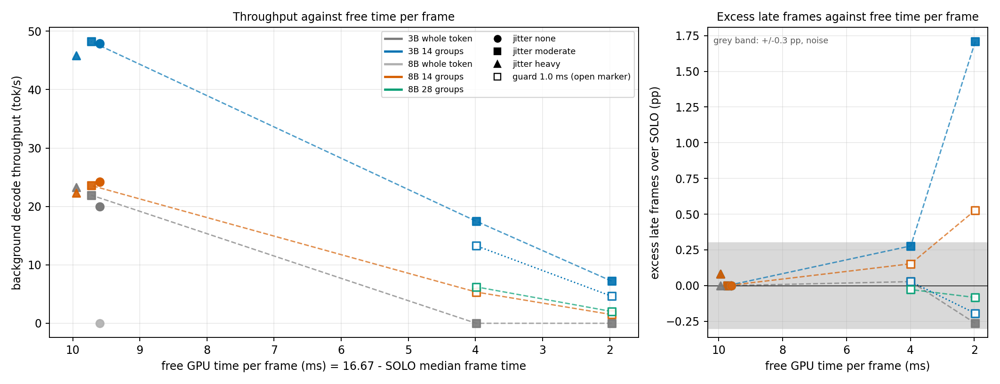
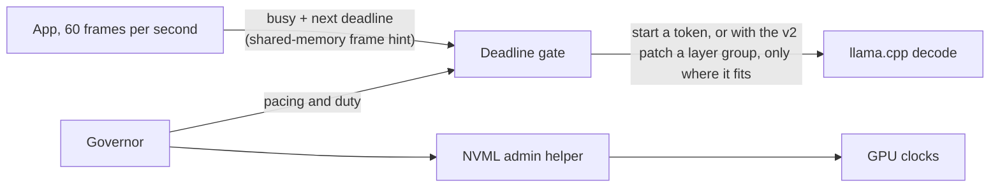

# Why you can't hyperthread a GeForce GPU, and what you can do instead

A toolkit for sharing one laptop GPU between a deadline-bound app and a local LLM.

On one RTX 4070 Laptop GPU, with a synthetic CUDA foreground at 60 fps and the clock locked at 1800 MHz, gating llama.cpp between layer groups lets decode use gaps shorter than a token. At 4 ms of free GPU time per frame the 3B produced 17.5 tok/s against 0 for whole-token gating, with no detectable added lateness; at 2 ms it produced 7.2 tok/s at +1.7 pp late frames. Splitting a token into 14 groups costs 1.4% (8B) to 2.2% (3B) per token, measured without a foreground.

## v2: pausable decode

llama.cpp decodes a token as one CUDA graph, so v1 could start a token only if a whole token fit between frames. v2 splits the token into layer groups with a pause point between them and gates each group on the frame hint, so decode can use a gap shorter than a token. The tables below are generated from the logged data by `tools/readme_numbers.py`, and `python tools/readme_numbers.py --check README.md` fails if they drift from it. The check also requires the numbers in the sentences under "What the tables show" (and in the first paragraph) to match the data, so those sentences are generated text too.

<!-- numbers:begin -->

Handover-latency cells, Llama-3.2-3B, 60 s, scene S0 (constant 7 ms frame), a marker kernel before every frame, 2 reps, no SOLO baseline, 1800 MHz lock, 60 fps (sprint 2, experiment 1). Late-frame rates here are not comparable with the end-to-end cells below. There are four rows: the two ungated arms (G1 is a whole token, G14 is 14 groups) and the two gated arms.

| decode arm | tok/s | late frames |
|---|---|---|
| ungated, whole token (G1) | 33.5 | 100.00% |
| ungated, 14 groups (G14) | 33.9 | 100.00% |
| whole-token gate | 0.0 | 0.06% |
| group gate (14 groups) | 44.6 | 0.22% |

The 0.06% for the whole-token gate is the foreground's own lateness, because that arm decoded 0 tokens (bg_tokens=0).

End-to-end cells, sprint 2 (experiment 3): scenes S1 and S5 of the v1 evaluation, 3 reps of 60 s per cell, 1800 MHz lock, guard 0. Throughput is the median of the reps (each rep in brackets), power the median of the reps:

| scene, model | gate | tok/s | late frames | power |
|---|---|---|---|---|
| S1, 3B | whole-token gate | 19.95 [19.95, 19.95, 19.98] | 0.00% | 41.7 W |
| S1, 3B | 14-group gate | 47.88 [47.95, 47.88, 47.82] | 0.00% | 57.9 W |
| S5, 8B | whole-token gate | 0.00 [0.00, 0.00, 0.00] | 0.00% | 31.7 W |
| S5, 8B | 14-group gate | 24.22 [24.20, 24.22, 24.25] | 0.00% | 59.2 W |

Decode throughput against free GPU time per frame, Llama-3.2-3B, moderate frame-cost jitter (lognormal frame cost with a coefficient of variation of 0.15, submit time within plus or minus 1 ms, 5% unannounced bursts), gate guard 0. Free time is 16.67 ms minus the median frame time of the foreground alone. The 9.7 ms row is sprint 3 (median over 3 reps, foreground S1); the 4.0 and 2.0 ms rows are sprint 4 (mean over 2 reps, a calibrated constant-cost S0 foreground). The foregrounds differ, so the rows show a trend, not one measured curve:

| free ms per frame | whole-token gate, tok/s | 14-group gate, tok/s | late frames added by 14-group decode, pp: aggregate (each rep) | foreground alone misses |
|---|---|---|---|---|
| 9.7 | 21.9 | 48.2 | +0.00 (+0.00, +0.00, +0.00) | 0.0% |
| 4.0 | 0.0 | 17.5 | +0.28 (+0.53, +0.03) | 3.8% |
| 2.0 | 0.0 | 7.2 | +1.71 (+2.28, +1.14) | 29.3% |

Cost of pausing at 14 groups against one piece per token, no foreground, 1500 MHz (sprint 1; the 8B longest piece is from the sprint 2 summary):

| model | overhead per token | longest uninterruptible piece | output |
|---|---|---|---|
| Llama-3.2-3B | 2.2% | 1.95 ms | token-identical |
| Llama-3.1-8B | 1.4% | 3.61 ms (p99 3.74) | token-identical |

<!-- numbers:end -->

What the tables show, each with its source:

1. Pausing makes a token 1.4% (Llama-3.1-8B) to 2.2% (Llama-3.2-3B) slower at 14 groups, with token-identical output. The longest uninterruptible piece is 1.95 ms for the 3B and 3.61 ms for the 8B (p99 3.74 ms). The 8B piece is above the 2.5 ms group limit of sprint 1 (the 3B meets it), and at about 2 ms of free time per frame it is longer than the whole gap, which is why the 8B collapses there. Source: [docs/V2_SPRINT1_PAUSE_COST.md](docs/V2_SPRINT1_PAUSE_COST.md), `data/v2/s1_pause/`, `data/v2/s2/summary.json`.
2. With the gate on, the whole-token gate gave 19.95 tok/s in S1 (3B) and 0.0 in S5 (8B); the 14-group gate gave 47.9 and 24.2, with 0.00% late frames in all 12 cells (3 reps). Without a gate every frame was late in the handover cells (S0), at 33.5 tok/s for whole tokens and 33.9 for 14 groups. In the handover cells the whole-token gate's 0.06% is the foreground's own lateness, since that arm decoded no tokens, and the group gate's 0.22% is not comparable with the end-to-end cells. Source: [docs/V2_SPRINT2_HANDOVER.md](docs/V2_SPRINT2_HANDOVER.md), `data/v2/s2/`.
3. As the free time per frame shrinks from 9.7 ms to 2.0 ms, the 14-group gate keeps a share of the throughput (48.2, 17.5 and 7.2 tok/s), while the whole-token gate gives 21.9 tok/s at 9.7 ms and 0.0 at 4.0 ms and below. At 4 ms free the excess over the foreground alone is +0.28 pp (reps +0.53 and +0.03), inside the +/-0.3 pp noise band of this design (REPORT_V2.md), so no added lateness was detected. At 2 ms free it is +1.71 pp (reps +2.28 and +1.14); rep 1 is above the sprint's 2 pp pass limit and the pass rests on the mean of two reps. The foreground alone misses 3.8% and 29.3% of its own frames at those levels. The 2 pp limit is the sprint 4 decision rule, fixed before measuring: the best 3B group arm may add at most 1 pp of late frames at 4 ms free and 2 pp at 2 ms free over the foreground alone, judged on the mean of the reps. Source: [docs/V2_SPRINT3_JITTER.md](docs/V2_SPRINT3_JITTER.md), [docs/V2_SPRINT4_LOW_SLACK.md](docs/V2_SPRINT4_LOW_SLACK.md), `data/v2/s3/`, `data/v2/s4/`.

### Preconditions

These results hold only under these conditions.

- The GPU clock is locked at 1800 MHz through the admin helper (sprint 1 used 1500 MHz).
- Gate guard is 0 ms and the gate waits by spin-waiting, unless a table says otherwise.
- There is no power control: the 14-group gate draws 57 to 60 W (60.3 W once, with the 8B in sprint 3), above the 60 W budget of the v1 evaluation in that one case.
- Prefill is not split into groups; only decode is pausable.
- Each cell has 2 to 3 reps.
- HAGS was on when it was recorded in v1 ([journal/0010](journal/0010_2026-10-21_hags-state.md)); the v2 sprint data do not record it, and it was not varied.
- GPU memory use was not recorded; one model at a time ran next to the foreground on the 8 GB card, and memory pressure was not tested.
- The foreground is CUDA, not Direct3D.
- The foreground is a synthetic kernel loop, not a game.
- One machine, one GPU, Windows 11.

Layer-level preemption of LLM work is established ([ConServe](https://arxiv.org/abs/2410.01228), [QLLM](https://arxiv.org/abs/2503.09304), [LayerLoom](https://arxiv.org/abs/2611.00652), [Ripple](https://arxiv.org/abs/2611.01067); GPU-level preemption and sharing: [REEF](https://www.usenix.org/conference/osdi22/presentation/han), [Hummingbird](https://arxiv.org/abs/2601.04071), [GCAPS](https://arxiv.org/abs/2406.05221), [FIKIT](https://arxiv.org/abs/2311.10359), [VUDA](https://arxiv.org/abs/2605.01352)). What v2 adds is a measurement of applying it to cross-process sharing on one consumer Windows GPU against a 60 fps frame deadline, with no driver support; see section 8 of the report.

The gates are static rules; this is not a registered comparison with the v1 governor.



The figure joins conditions from three sprints that differ in foreground scene, guard and jitter; the caption in the report says how. Read [the v2 report](docs/report/REPORT_V2.pdf) (6 pages, source [REPORT_V2.md](docs/report/REPORT_V2.md), claim table [SOURCES_V2.md](docs/report/SOURCES_V2.md)) and [how the mechanism works and how to build the patched llama.cpp](docs/PAUSABLE_DECODE.md). The v1 results follow: [v1: three measured results](#v1-three-measured-results).

## v1: three measured results

Three measured results, each with its source:

1. LLM decode keeps 96% of its throughput at 39% less power when the GPU clock is locked at 1500 MHz: 97.25 tok/s against 101.1 unlocked, at 56.3 W against 92 W. Source: [docs/W2_SUMMARY.md](docs/W2_SUMMARY.md) (row L), [data/w2_L_results.md](data/w2_L_results.md).
2. A governor that adapts to the app produced 41.3 tok/s against 32.0 for the best fixed setting (+29%) when the app goes idle, both at 0.04% late frames (median). This is a comparison made after the registered analysis, and the governor missed its registered target (see Results below). Source: [docs/W5B_RESULTS.md](docs/W5B_RESULTS.md) (observation 3), [data/w5b/eval_descriptive.md](data/w5b/eval_descriptive.md).
3. Windows time-slices two CUDA processes with a 0.374 ms quantum and a 0.148 ms switch gap. While both processes have work, each runs at about 1/2.5 to 1/2.8 of its solo speed (2.5 fitted to measured runs, 2.79 derived from the two figures above). Source: [docs/W2_SUMMARY.md](docs/W2_SUMMARY.md) (row G and note 4), [docs/CONCEPTS.md](docs/CONCEPTS.md), [data/sim_calibration.json](data/sim_calibration.json).

Two separate, uncoordinated processes on a GeForce GPU on Windows cannot be partitioned: MPS and MIG are unavailable, so an app such as a game and an LLM share the chip by time slices, and a token that overlaps a frame delays it. NVIDIA's NVIGI SDK ([GPU Scheduling for AI](https://docs.nvidia.com/nvigi-sdk/1.7.0/docs/nvigi_core/docs/GpuSchedulingForAI.html)) covers the case where the game embeds the inference: it takes the game's D3D12 queue, runs CUDA or D3D12 compute in parallel with the game's graphics, and sets a priority hint between them. I have not used it or compared against it. The toolkit makes the app tell the LLM when the next frame is due, and the LLM starts a token, or with the v2 patch a layer group, only where it fits.



## What's in the box

| piece | what it does | where |
|---|---|---|
| Frame hint | the app publishes "busy" and "next frame due" in a 40-byte shared-memory record; a spec you can implement from scratch | [docs/FRAME_HINT_SPEC.md](docs/FRAME_HINT_SPEC.md), `include/slackhint.h` (C), `python/slackhint` (Python) |
| Deadline gate | starts a work unit only where it finishes before the next frame; importable as `DeadlineGate` | `python/governor`, and in C++ `workloads/background/pacing.h`, `pace_view.h`, `tok_estimate.h` |
| Governed llama.cpp driver | decodes on the GPU under the gate and a control block | `workloads/background/llama_governed_bench.cpp` (build: `build_llama_governed.bat`) |
| Pausable decode driver (v2) | the same gate applied before every layer group instead of every token | `workloads/background/llama_handover_bench.cpp` |
| llama.cpp pause patch (v2) | about 65 changed lines that split the decode graph into layer groups with a pause point between them | `workloads/background/pause_patch/`, [docs/PAUSABLE_DECODE.md](docs/PAUSABLE_DECODE.md) |
| Governor | picks clock, pacing mode, duty and guard under a power budget; four controllers | `controllers/`, `telemetry/` |
| NVML admin helper | the only process that locks GPU clocks, with a command allowlist and a threat model | `actuators/clock_helper.py`, [docs/W45_CLOCK_HELPER_SECURITY.md](docs/W45_CLOCK_HELPER_SECURITY.md) |
| Harness | synthetic 60 fps app, registered experiment protocols, analysis, pytest suite | `workloads/foreground/frame_loop.py`, `experiments/`, `analysis/`, `tests/` |
| Simulator | plant model fitted to the measurements, used to design and test the controllers | `sim/` |
| Dashboard | local web page with a simulator, replay of recorded runs and a live view | `tools/dashboard/` |

## Quickstart without a GPU

Needs Windows 10 or 11 (the hint is a named file mapping) and Python 3.10 or later; the code was developed on 3.12. From the repository root:

```
git clone https://github.com/arjunpatil0/governor.git
cd governor
python -m venv .venv
.venv\Scripts\activate
pip install -e ".[test]"
python examples/minimal_gate.py
python examples/demo_slack_hint.py
python -m pytest tests/test_governor_package.py tests/test_slackhint_py.py -q
python tools/dashboard/server.py
```

Behind a proxy that intercepts TLS, pip may fail certificate checks while it builds the package; setting `PIP_USE_FEATURE=truststore` before the install fixes that. `minimal_gate.py` runs the plant simulator with and without the gate and then drives the importable gate in simulated time. `demo_slack_hint.py` runs two small processes with spin-loop stand-ins. The dashboard server prints `http://127.0.0.1:8765/`; open it and the page starts in simulator mode with a guided tour. To try the live view with a synthetic feed, run `python tools/dashboard/fake_session.py --seconds 60` in a second terminal and pick Live in the page. Nothing in this section touches a GPU, and the page labels every simulated or synthetic mode as such. The full suite (`python -m pytest tests -q`) also needs MSVC for the C tests and, for three tests, the llama.cpp build and a GPU; without those it reports three failures (`test_governed_driver_build`, two in `test_llama_driver`) and skips a few more.

The package alone (`pip install .`) has no dependencies:

```python
from governor import FrameHintWriter, FrameHintReader, DeadlineGate
```

## Quickstart with a GPU

Requirements: an NVIDIA GPU (the data come from an RTX 4070 Laptop, driver 616.92 for the v1 runs), Windows 11, Python with the packages above plus `nvidia-ml-py`, CUDA 13.1 and MSVC Build Tools to build the driver, the pinned llama.cpp in `third_party/` and model files in `data/llama/`. Clock locking needs an Administrator PowerShell running the helper, started with a config file; the setup steps are at the top of `actuators/clock_helper.py` and in [docs/W45_CLOCK_HELPER_SECURITY.md](docs/W45_CLOCK_HELPER_SECURITY.md). The v1 experiments also followed a run checklist (AC power, a fixed power mode, a clean committed tree, a fresh restart) described in [docs/W5B_EVALUATION.md](docs/W5B_EVALUATION.md). With the helper running, a demo of one scene is:

```
python tools/dashboard/demo.py --scene S1 --model 3b --manager dB --armoury-mode Performance
```

and then Live in the dashboard. The scene and manager codes are defined in the report; `S1` is a frame cost that steps between 0.7 and 1.3 times nominal every 10 s and `dB` is the learned governor.

## Results

The evaluation was pre-registered (hypotheses and thresholds committed before the data) and has 10 blocks and 425 runs on one laptop. The governor did not meet its registered target. It stayed within the 60 W budget in every 60 W run, but in two of the five test scenes it missed the limit of 1% late frames in every block: 1.72% late in the scene with stepping frame cost and 4.72% in the same scene with a larger 8B model. Its throughput was also not shown to be within 5% of the primary reactive controller (median ratio 0.973, 90% interval 0.943 to 0.980, against a required lower bound of 0.95). The frame hint gave 60 tok/s with no late frames where a token fits the gap (diagnostic runs) and 0.0 to 0.04% median late frames in the registered runs where it fits. In v1 (whole-token gating), when a token is longer than the gap the hint can only stop the LLM, and there is no controlled comparison against running without the hint.

Two later checks are documented. A worst-case read overhead of 0.25 W on the energy counter would move three registered outputs without changing the governor's verdict, and a driver-level power-sensor glitch of about 588 W at idle does not touch the registered figures; both are in [docs/AUDIT_590W.md](docs/AUDIT_590W.md). The full write-up, with every number traced to a file, is the technical report: [docs/report/REPORT.pdf](docs/report/REPORT.pdf) (source [docs/report/REPORT.md](docs/report/REPORT.md)). The longer project notes (dashboard reference, open prior-art list) are in [docs/PROJECT_DETAILS.md](docs/PROJECT_DETAILS.md).

## How this was built

Solo project, built with Claude Code and Claude. Claude Code wrote most of the code, the journal and the sprint documents under my review; a second Claude session wrote the reviews in `reviews/`. I chose the problem, set or approved each plan and decision rule, ran every hardware session and reviewed every result. v1 was pre-registered; v2 committed a forecast and a decision rule before each sprint. The v2 journal entries 0070 to 0075 were written after the fact. The full trail is in [journal/](journal/), [decisions/](decisions/) and [reviews/](reviews/).

Licence: MIT ([LICENSE](LICENSE)). Version 2.0.1, see [CHANGELOG.md](CHANGELOG.md).
