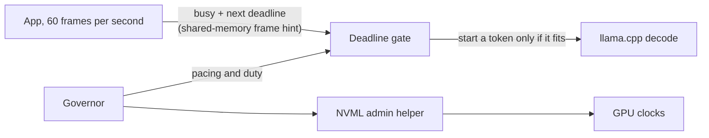

# Why you can't hyperthread a GeForce GPU, and what you can do instead

A toolkit for sharing one laptop GPU between a deadline-bound app and a local LLM.

Three measured results, each with its source:

1. LLM decode keeps 96% of its throughput at 39% less power when the GPU clock is locked at 1500 MHz: 97.25 tok/s against 101.1 unlocked, at 56.3 W against 92 W. Source: [docs/W2_SUMMARY.md](docs/W2_SUMMARY.md) (row L), [data/w2_L_results.md](data/w2_L_results.md).
2. A governor that adapts to the app produced 41.3 tok/s against 32.0 for the best fixed setting (+29%) when the app goes idle, with 0.00% and 0.04% late frames. This is a comparison made after the registered analysis, and the governor missed its registered target (see Results below). Source: [docs/W5B_RESULTS.md](docs/W5B_RESULTS.md) (observation 3), [data/w5b/eval_descriptive.md](data/w5b/eval_descriptive.md).
3. Windows time-slices GPU processes with a 0.374 ms quantum and a 0.148 ms switch gap. While both processes have work, each runs at about 1/2.5 to 1/2.8 of its solo speed (2.5 fitted to measured runs, 2.79 derived from the two figures above). Source: [docs/W2_SUMMARY.md](docs/W2_SUMMARY.md) (row G and note 4), [docs/CONCEPTS.md](docs/CONCEPTS.md), [data/sim_calibration.json](data/sim_calibration.json).

A GeForce GPU on Windows cannot be partitioned: MPS and MIG are unavailable, so a game and an LLM share the chip by time slices, and a token that overlaps a frame delays it. The toolkit makes the app tell the LLM when the next frame is due, and the LLM starts a token only where it fits.



## What's in the box

| piece | what it does | where |
|---|---|---|
| Frame hint | the app publishes "busy" and "next frame due" in a 40-byte shared-memory record; a spec you can implement from scratch | [docs/FRAME_HINT_SPEC.md](docs/FRAME_HINT_SPEC.md), `include/slackhint.h` (C), `python/slackhint` (Python) |
| Deadline gate | starts a work unit only where it finishes before the next frame; importable as `DeadlineGate` | `python/governor`, and in C++ `workloads/background/pacing.h`, `pace_view.h`, `tok_estimate.h` |
| Governed llama.cpp driver | decodes on the GPU under the gate and a control block | `workloads/background/llama_governed_bench.cpp` (build: `build_llama_governed.bat`) |
| Governor | picks clock, pacing mode, duty and guard under a power budget; four controllers | `controllers/`, `telemetry/` |
| NVML admin helper | the only process that locks GPU clocks, with a command allowlist and a threat model | `actuators/clock_helper.py`, [docs/W45_CLOCK_HELPER_SECURITY.md](docs/W45_CLOCK_HELPER_SECURITY.md) |
| Harness | synthetic 60 fps app, registered experiment protocols, analysis, pytest suite | `workloads/foreground/frame_loop.py`, `experiments/`, `analysis/`, `tests/` |
| Simulator | plant model fitted to the measurements, used to design and test the controllers | `sim/` |
| Dashboard | local web page with a simulator, replay of recorded runs and a live view | `tools/dashboard/` |

## Quickstart without a GPU

Needs Windows 10 or 11 (the hint is a named file mapping) and Python 3.10 or later; the code was developed on 3.12. From the repository root:

```
git clone https://github.com/arjunpatil0/governor.git
cd governor
python -m venv .venv
.venv\Scripts\activate
pip install -e ".[test]"
python examples/minimal_gate.py
python examples/demo_slack_hint.py
python -m pytest tests/test_governor_package.py tests/test_slackhint_py.py -q
python tools/dashboard/server.py
```

Behind a proxy that intercepts TLS, pip may fail certificate checks while it builds the package; setting `PIP_USE_FEATURE=truststore` before the install fixes that. `minimal_gate.py` runs the plant simulator with and without the gate and then drives the importable gate in simulated time. `demo_slack_hint.py` runs two small processes with spin-loop stand-ins. The dashboard server prints `http://127.0.0.1:8765/`; open it and the page starts in simulator mode with a guided tour. To try the live view with a synthetic feed, run `python tools/dashboard/fake_session.py --seconds 60` in a second terminal and pick Live in the page. Nothing in this section touches a GPU, and the page labels every simulated or synthetic mode as such.

The package alone (`pip install .`) has no dependencies:

```python
from governor import FrameHintWriter, FrameHintReader, DeadlineGate
```

## Quickstart with a GPU

Requirements: an NVIDIA GPU (the data come from an RTX 4070 Laptop, driver 616.92), Windows 11, Python with the packages above plus `nvidia-ml-py`, CUDA 13.1 and MSVC Build Tools to build the driver, the pinned llama.cpp in `third_party/` and model files in `data/llama/`. Clock locking needs an Administrator PowerShell running the helper, started with a config file; the setup steps are at the top of `actuators/clock_helper.py` and in [docs/W45_CLOCK_HELPER_SECURITY.md](docs/W45_CLOCK_HELPER_SECURITY.md). The experiments also followed a run checklist (AC power, a fixed power mode, a clean committed tree, a fresh restart) described in [docs/W5B_EVALUATION.md](docs/W5B_EVALUATION.md). With the helper running, a demo of one scene is:

```
python tools/dashboard/demo.py --scene S1 --model 3b --manager dB --armoury-mode Performance
```

and then Live in the dashboard. The scene and manager codes are defined in the report; `S1` is a frame cost that steps between 0.7 and 1.3 times nominal every 10 s and `dB` is the learned governor.

## Results

The evaluation was pre-registered (hypotheses and thresholds committed before the data) and has 10 blocks and 425 runs on one laptop. The governor did not meet its registered target. It stayed within the 60 W budget in every 60 W run, but in two of the five test scenes it missed the limit of 1% late frames in every block: 1.72% late in the scene with stepping frame cost and 4.72% in the same scene with a larger 8B model. Its throughput was also not shown to be within 5% of the primary reactive controller (median ratio 0.973, 90% interval 0.943 to 0.980, against a required lower bound of 0.95). The frame hint gave 60 tok/s with no late frames where a token fits the gap (diagnostic runs) and 0.0 to 0.04% median late frames in the registered runs where it fits; when a token is longer than the gap the hint can only stop the LLM, and there is no controlled comparison against running without the hint.

Two later checks are documented. A worst-case read overhead of 0.25 W on the energy counter would move three registered outputs without changing the governor's verdict, and a driver-level power-sensor glitch of about 588 W at idle does not touch the registered figures; both are in [docs/AUDIT_590W.md](docs/AUDIT_590W.md). The full write-up, with every number traced to a file, is the technical report: [docs/report/REPORT.pdf](docs/report/REPORT.pdf) (source [docs/report/REPORT.md](docs/report/REPORT.md)). The longer project notes (dashboard reference, open prior-art list) are in [docs/PROJECT_DETAILS.md](docs/PROJECT_DETAILS.md).

Licence: MIT ([LICENSE](LICENSE)). Version 1.0.0, see [CHANGELOG.md](CHANGELOG.md).
