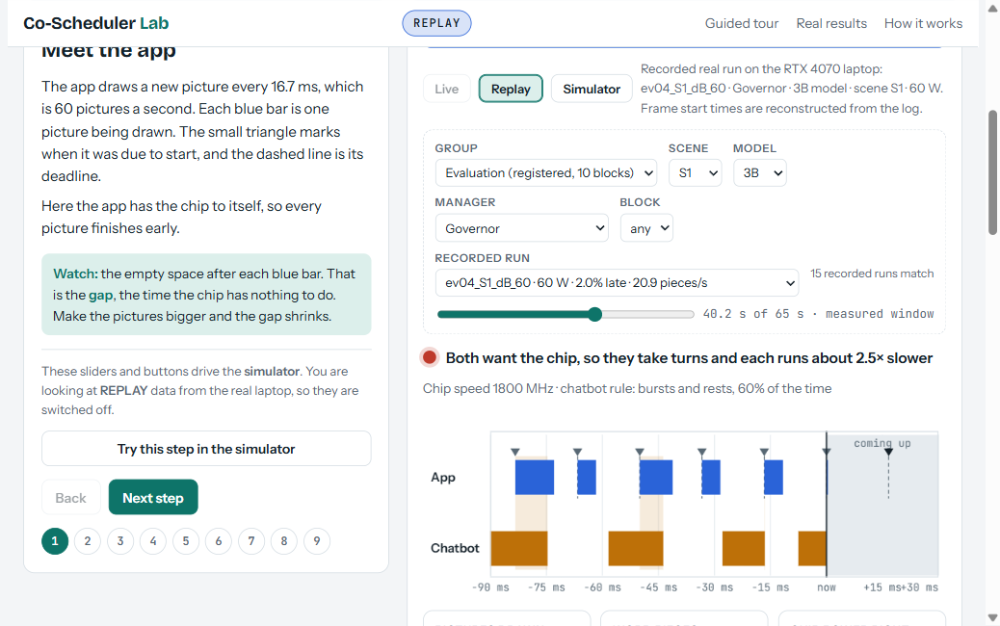

# Project details (the previous README, kept in full)

The README at the repository root is the short entry point. This file keeps the longer project notes that it used to hold: the component table, the measured results with their limits, the dashboard commands and safety notes, the repository map and the open prior-art list. Links were adjusted to this folder; the text is otherwise unchanged from the README of commit 4a86c42.

# governor: frame-slack hints and a power-budget governor for a GPU shared by a 60 Hz app and a background LLM

**Status: research prototype, one Windows laptop, results mostly negative or inconclusive for the learned controller. No novelty is claimed (see the prior-art TODO).**

## What it is
- A **foreground** synthetic FMA workload runs at 60 Hz (deadline 16.667 ms; goal: miss rate <= 1%).
- A **background** llama.cpp decode (CUDA, 1B/3B/8B models) shares the same GPU under Windows WDDM time-slicing.
- **Frame-slack hints** (the reusable part): the foreground publishes *busy* and *next deadline* through a 40-byte seqlock shared-memory record; the background starts a token only if it fits before the deadline. Spec: [docs/SPEC_FRAME_SLACK_HINTS.md](SPEC_FRAME_SLACK_HINTS.md). Library: `include/slackhint.h` (C) and `python/slackhint` (Python).
- A **governor** (optional) sets the SM clock, the pacing mode (slack filling or duty cycle) and the duty to **maximise background tokens/s under a mean-GPU-power budget** (60 W primary, 35 W exploratory) while the foreground keeps its deadline.
- Everything was pre-registered (experiments/w5_governor.yaml and addenda) before the evaluation data; the analysis was run once ([docs/W5B_RESULTS.md](W5B_RESULTS.md)).

## Architecture
```
 foreground app (60 Hz)                         background worker (llama.cpp decode, CUDA)
 workloads/foreground/frame_loop.py             workloads/background/llama_governed_bench.cpp
        |  FramePublisher (telemetry/fg_publisher.py)            ^   reads hints + control
        |  busy@-1 ms / not-busy + next deadline                 |
        v                                                        |
   +--------------------+   hints (SeqBlock, 3 doubles)   +-----------------+
   | pace block         | ------------------------------> | PaceView        |  fit rule: now + estimate + guard <= next deadline
   | busy, next_dl, t   |   (include/slackhint.h)         | + clean-token   |  duty gap (power throttle), >100 ms stale = app idle
   +--------------------+                                 |   estimate      |
        |                                                 +-----------------+
        |  frame ring (t_sched, t_start, t_end)                    ^
        v                                                          | control block [pacing, duty, guard_ms]
   telemetry daemon -----> governor loop (controllers: g'B static, eB idle-drop, c'B PI, d'B learned hybrid)
   (NVML power, clocks)            |
                                   | SM clock requests
                                   v
                    clock-control service (admin helper, allowlisted)   actuators/clock_helper.py
```

## Components
| component | where | status |
|---|---|---|
| **Protocol** (record layout, producer and consumer rules, failure modes) | [docs/SPEC_FRAME_SLACK_HINTS.md](SPEC_FRAME_SLACK_HINTS.md) | v1 draft, described from what was run |
| **Library** | `include/slackhint.h` (C99/C++, Windows), `python/slackhint/` (byte-compatible) | extracted 2026-11-06 from the experiment code; 22 tests |
| **Governed llama.cpp integration** | `workloads/background/llama_governed_bench.cpp` with `shm.h`, `pace_view.h`, `pacing.h`, `tok_estimate.h`; build: `workloads/background/build_llama_governed.bat` against the pinned llama.cpp in `third_party/` | used for all evaluation data; GPU-only (aborts if any layer is not offloaded). The evaluation's exe has sha256 prefix `bb875fbcaa2cf792`: rebuilding changes it and breaks comparability with the registered data |
| **Optional controller / governor** | `controllers/` (static g'B, eB idle-drop, c'B PI, hybrid d'B), `telemetry/` (daemon, rings), `sim/` (plant simulator, frozen) | d'B did not earn its place (below) |
| **Clock-control service** | `actuators/clock_helper.py` (runs as Administrator, command allowlist) and `clock_client.py`; threat model in [docs/W45_CLOCK_HELPER_SECURITY.md](W45_CLOCK_HELPER_SECURITY.md) | needed only for the governed experiments |
| **Conformance harness** | pytest suite, no GPU: `tests/test_slackhint_py.py`, `tests/test_slackhint_c.py` (the new library), and the experiments' own `tests/test_shm_cpp.py`, `test_pace_view_cpp.py`, `test_pacing_cpp.py`, `test_tok_estimate_cpp.py` | a test suite, not a standalone tool |

## Measured results and their limits
All numbers trace to the cited file. One machine (ASUS laptop, RTX 4070 Laptop), Windows 11, Armoury Crate Performance mode, AC power, 100 s per cell, 10 paired blocks per 60 W cell and 5 per 35 W cell.

**Registered verdict ([docs/W5B_RESULTS.md](W5B_RESULTS.md), data/w5_results.md): the learned controller d'B does NOT earn its place.**
- HW1 (foreground miss <= 1% and power <= 60 W) holds for d'B in S0, S1d, S2 and fails in S1 (median miss 1.72%) and S5 (4.72%), 0/10 feasible each.
- S5 superiority is inconclusive (all five arms score 0 in all blocks, so the exact test cannot reject); S0 non-inferiority vs the primary c'B comparator fails (median ratio 0.973, 90% CI [0.943, 0.980], needs lower bound >= 0.95).
- At 35 W (exploratory, HW1 only) d'B was feasible in 0 of 25 cells; only the static g'B and the idle-drop eB held HW1.
- Post hoc, labelled as such in the results file: the static aligned baselines made **0 background tokens in S0 and S5** (no token fits the slack there) yet count as feasible; the S1/S5 misses match the per-cell tuning misses (the six-cell mean of 0.86% hid them); the interleaving-under-time-slicing explanation of the misses is a hypothesis, untested.

**What the hint channel itself showed** ([spec sections 6-7](SPEC_FRAME_SLACK_HINTS.md)): a failed seqlock read treated as "app idle" made the driver start tokens at every publish (25368 phantom-idle polls in 5 s in the mechanism reproduction, 0 after the fix); with the fix, slack filling gave 60 tok/s at light frames with foreground miss 0.000 (smoke 3, diagnostic), and the static aligned setting held 0.0-0.04% median miss in S1, S1d and S2 where tokens fit (data/w5b/eval_descriptive.md). Limits: no controlled no-hint ablation; the staleness of the token estimate after clock changes is untested (HW7 data logged, not analysed); one GPU, one OS, one frame rate, one background workload family; the d'B-HGB variant and scene S3 were never built.

## How to run
**Demo (no GPU, no admin; spin-loop stand-ins, an illustration, not a measurement):**
```
python examples/demo_slack_hint.py
python examples/demo_slack_hint.py --frame-ms 9 --unit-ms 10
```
**Tests (Windows; the C tests need MSVC Build Tools at the path in `tests/test_shm_cpp.py`):**
```
python -m pytest tests/test_slackhint_py.py tests/test_slackhint_c.py
```
**Library use:** C/C++: `#include "slackhint.h"` (`/I include`), producer `slackhint_producer_create`, `slackhint_frame_started` / `slackhint_frame_done`; consumer `slackhint_consumer_open`, `slackhint_get`, `slackhint_may_start`. Python: `PYTHONPATH=python`, `import slackhint as sh`; `sh.Producer(name)`, `sh.Consumer(name)`, `sh.may_start(...)`.
**Governed experiments with the GPU (not a demo):** need the pinned llama.cpp build, model files, the admin clock helper, a fresh restart and the other conditions of [docs/W5B_EVALUATION.md](W5B_EVALUATION.md); current state in [STATUS.md](../STATUS.md).

## Dashboard (Co-Scheduler Lab, live)
A local web page (design, tour text and simulator from `docs/dashboard_reference.html`, reused) that shows the system in three data modes. **The page always labels its mode** (a pill in the top bar, a banner and a line in the stage): **SIMULATOR** (the in-page simulator; the guided tour; used when nothing is connected), **REPLAY** (any recorded cell of `data/`, played back from its `frames.npz`: evaluation, tuning, trials and demos, with a cell picker by group, scene, model, manager and block, play/pause, speed and a seek bar; the 12-second panel shows that run's recorded result), **LIVE** (a running demo: real frames, tokens, clock, sampled power and the governor's decisions, drawn about 0.12 s behind so that frames and tokens in progress are known). The tour keeps working in every mode: in REPLAY and LIVE its sliders are switched off (they drive the simulator) and each step offers "Try this step in the simulator".



**Commands** (Windows, from the repository root; the server needs no admin rights and no new packages):
```
python tools/dashboard/server.py                    # serves http://127.0.0.1:8765/ (loopback only, read-only, low priority)
start msedge http://127.0.0.1:8765/                 # open the page (Edge or Firefox; Chrome must be closed for a demo, see below)
start msedge "http://127.0.0.1:8765/?mode=replay&cell=w5b/eval/block04/cells/ev04_S2_dB_60"       # replay one recorded cell directly
python tools/dashboard/fake_session.py --seconds 60                                                 # GPU-free SYNTHETIC live feed to try LIVE (labelled synthetic)
```
**A live demo on the real GPU** (needs the admin clock helper running in its own Administrator window, exactly as for a registered cell; AC power, Armoury mode stated, clean committed tree, fresh restart, Chrome closed):
```
python tools/dashboard/demo.py --scene S1 --model 3b --manager dB --armoury-mode Performance
```
then pick LIVE in the page. Managers: `a`, `gB`, `eB`, `cBb`, `dB`; scenes S0 S1 S1d S2 S5; models 1b 3b phi 8b. A demo runs the evaluation's own cell for that scene and manager (frozen constants, same executor; only the model may differ), takes about 100 s, writes `data/dashboard_demos/<utc>_<id>/` (cell, frames, driver log, per-tick governor reasoning, `meta.json` with `"demo": true`) and never touches `data/w5b/eval`. Demos are not registered data. They appear under "Demos" in the REPLAY picker, with the governor's full reasoning.

**Safety.** The server binds 127.0.0.1 only (any other `--host` is refused), checks Host and Origin, never writes a ring, a control block or the clock helper, and reads NVML only for the sampled power and the SM clock, never the energy counter (phantom-energy finding, addenda O-4 and O-5); NVML samples above 250 W are dropped as glitches (the laptop returned 590 W samples). **Do not run it during registered experiments** (it adds CPU load and NVML polling): it refuses to start while `evaluate.py`, `tune.py` or the w5a runner is running. The Governor's decision telemetry is an optional hook, default off (`controllers/runtime.py`, `telemetry/decision_block.py`); only `demo.py` switches it on, in its own process. A test replays a seeded scenario through the real d'B, c'B and eB controllers and checks the action sequences equal a golden file recorded before the hook existed.

**Server overhead** (measured 2026-11-06 on this laptop, one SSE client at 20 messages/s): REPLAY 1.0 to 1.3% of one core; LIVE on a synthetic 60 Hz feed with real NVML polling 2.5 to 3.4% of one core (one run with the page open in Chrome 2.5%). Not yet measured: the overhead during a demo on the real GPU (`demo.py` records the server's CPU during the run in the demo's `meta.json` when the server is up) and the cost of the decision hook on the Governor thread.

## Repository map
`docs/` plans, addenda, results, concepts (docs/CONCEPTS.md), paper map (docs/PAPER_MAP.md), timeline; `journal/` append-only session journal; `decisions/` ADRs; `experiments/` registered protocols and runners; `analysis/` registered and post hoc analysis; `reviews/` reviewer notes and responses; `data/` measured data (every cell has its record).

## Open TODO: prior-art search (nothing below has been searched; no claim of novelty)
Search terms to run before any claim or paper: "slack stealing" real-time scheduling; aperiodic / background server in periodic real-time systems; cooperative scheduling hints through shared memory (seqlock, futex-style); latency-critical + best-effort GPU co-location; GPU time-slicing / preemption for inference next to graphics; Windows WDDM GPU scheduling priority (D3DKMT, GPU scheduling class); MPS / MIG / green-context co-location; frame-pacing hints compositor / game engine; deadline-aware DVFS under a power cap; power-capped co-scheduling of inference; LLM decode interference with a real-time rendering loop; power-budget governors for laptops. Each hit must be verified to exist before it is cited. No LICENSE file exists yet: add one before sharing.

## Technical report
An engineering write-up of the toolkit, its design, the pre-registered validation and its limits (5 pages): [docs/report/REPORT.pdf](report/REPORT.pdf), source [docs/report/REPORT.md](report/REPORT.md). Every number is traced to a file and line in [docs/report/SOURCES.md](report/SOURCES.md) (generated and checked by `python docs/report/build_sources.py`); the style-guide check is in [docs/report/STYLE_CHECK.md](report/STYLE_CHECK.md). Rebuild: `python docs/report/make_figures.py && python docs/report/build_report.py` (Chrome renders the PDF; pandoc and LaTeX are not installed here).
