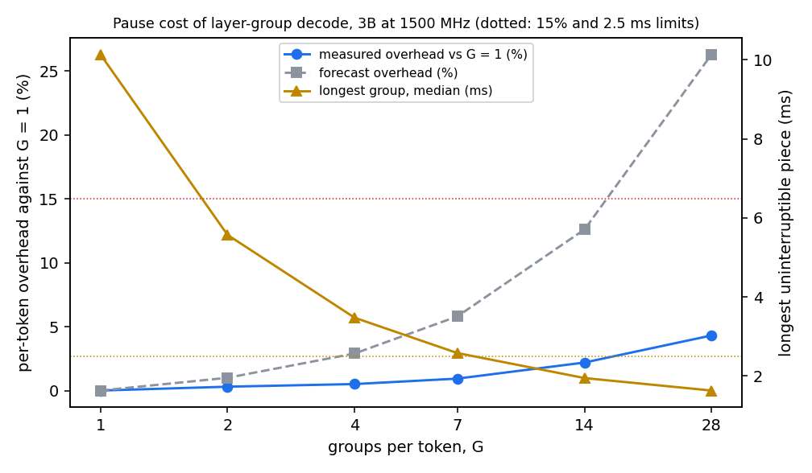

# V2 sprint 1: what it costs to make LLM decode pausable at layer boundaries

## Verdict

GO, by the decision rule fixed before measuring: at G = 14 groups the longest uninterruptible piece is 1.95 ms (p99 2.02 ms) and the per-token overhead against G = 1 is 2.2% (0.3% at G = 2, 4.3% at G = 28). Sprint 2 can build the real pausable decode. The forecast was wrong in the direction that helps: it expected 12.6% at G = 14, the measurement is 2.2%.

Branch v2-foreground. One question: if one token's decode is split into G groups of layers with a pause point between groups, how much slower does each token get, and how long is the longest uninterruptible piece? Written in the order it was done; the forecast was committed (83db807) before any measurement.

## Decision rule (fixed before measuring)

- GO: some G has a longest group of at most 2.5 ms and a total per-token overhead of at most 15% against G = 1. Sprint 2 builds the real pausable decode.
- MARGINAL: the overhead at that G is 15 to 30%. Reported for the owner to decide.
- STOP: the overhead is above 30%, or no G gets the longest group below 2.5 ms. Written up as a finding on why layer-level preemption does not pay on WDDM at this scale.

Which one applies: GO. G = 7 narrowly misses the group limit (2.58 ms against 2.5 ms); G = 14 (1.95 ms, 2.2%) and G = 28 (1.63 ms, 4.3%) meet both conditions.

## Path taken

A real split, not the proxy. The patched llama.cpp (a copy of the pinned tree, `third_party/llama.cpp_v2`, patch in `workloads/background/pause_patch/apply_pause_patch.py`) runs each token as G CUDA graphs, one per group of layers, and between groups the host synchronises the stream and calls a hook that reads a frame-hint record. The tokens it produces are identical to the stock path: all nine configurations give the same 320 tokens. The pinned build and the v1 driver exe were not touched; the patched build lives in its own directory.

### Feasibility reading (pinned llama.cpp, commit 620d2225c, version 0.7.0)

Where the graph is captured and launched. `ggml_backend_cuda_graph_compute` (ggml/src/ggml-cuda/ggml-cuda.cu, line 4684) decides whether to use a CUDA graph for the whole ggml compute graph of one token. If it does, it begins stream capture (`cudaStreamBeginCapture`, line 4739), evaluates every node in `ggml_cuda_graph_evaluate_and_capture` (line 4449), ends capture (`cudaStreamEndCapture`, line 4638), instantiates or updates the executable graph and launches it once with `cudaGraphLaunch` (line 4659). The captured graphs are kept in a map keyed by the first node of the cgraph (`ggml_cuda_graph_get_key`, `cuda_graphs` in common.cuh line 1463), so several graphs per backend context already work if the cgraph handed in differs.

(a) Minimal patch, as built. In `ggml_backend_cuda_graph_compute`, when `GGML_CUDA_PAUSE_GROUPS` is set to G above 1 (default off, so the stock behaviour is unchanged), partition `cgraph->nodes` into G contiguous ranges that end after the node named `l_out-<layer>` (llama.cpp names each layer's output that way), take a view of each range, run each view through the same capture and launch path (each view has its own first node, hence its own graph key), synchronise the stream after each group and call a host hook with the group's host launch and completion times and its GPU time between two CUDA events. About 60 lines in ggml-cuda.cu and 4 in ggml-cuda.h. One correction to the plan: `ggml_graph_view` is not exported from ggml-base.dll (the first link failed), so the wrapper copies the struct and sets the same fields. The driver (`workloads/background/llama_pause_bench.cpp`, a copy of the decode driver with the hook) is about 150 lines.

(b) State across a pause. Activations live in the compute buffer that ggml's graph allocator plans once for the whole graph, and the KV cache lives in persistent backend buffers. Splitting the node list keeps the node order, so nothing is freed or reused earlier than in the whole graph, and no copies are needed. This held in practice: the tokens are identical to the unsplit run at every G.

(c) What forces graphs off. The environment switch `GGML_CUDA_DISABLE_GRAPHS`; a mul_mat_id node that needs a synchronise (mixture-of-experts models, not the 3B); node properties that change from one token to the next (the code then resets its warm-up and runs the nodes directly until the graph is stable again); and the capture lock around `cudaStreamBeginCapture`. For this 3B the graph was stable over the 300-token runs. A split view has uid 0, so its node properties are compared on every call; that host-side cost is inside the measured overhead.

## Forecast vs measured

Forecast committed before measuring: 100 microseconds per boundary (range 50 to 200), a baseline of 10.28 ms per token, about 0.33 ms per layer and 0.8 ms for the output projection. Measured: 3B Q4_K_M, SM clock locked at 1500 MHz, nothing else on the GPU, 3 reps of 300 tokens per configuration after 20 warm-up tokens, configurations interleaved by rep. Token time is the wall time of one decode plus the greedy sample; overhead is the median token time against G = 1 (rep medians of G = 1: 10.139, 10.135, 10.141 ms).

| G | forecast overhead | measured overhead (range over reps) | forecast longest group | measured longest group (median, p99) | measured cost per boundary |
|---|---|---|---|---|---|
| 1 | 0% | 0% (token 10.14 ms) | 10.3 ms | 10.14 ms | n/a |
| 2 | 1.0% | 0.3% (0.17 to 0.50) | 5.4 ms | 5.57 ms (5.77) | 31 us |
| 4 | 2.9% | 0.5% (0.28 to 0.66) | 3.1 ms | 3.47 ms (3.61) | 17 us |
| 7 | 5.8% | 0.9% (0.83 to 1.01) | 2.1 ms | 2.58 ms (2.68) | 16 us |
| 14 | 12.6% | 2.2% (2.12 to 2.28) | 1.5 ms | 1.95 ms (2.02) | 17 us |
| 28 | 26.3% | 4.3% (4.23 to 4.32) | 1.1 ms | 1.63 ms (1.68) | 16 us |
| graphs off (reference) | not forecast | +14.2% (13.4 to 15.4), token 11.58 ms | not applicable | not applicable | not applicable |

The cost per boundary is 16 to 31 microseconds, a fifth to a third of the forecast 100. The host-visible gap between one group's completion and the next launch is about 1 microsecond, and the frame-hint check takes under 1 microsecond, so the cost sits in the drained stream (the tail of the last kernel of a group running alone, and the start of the next graph), not in the host. The overhead is nearly linear in G, as the forecast model says, with a smaller slope. The longest-group forecast was low by 0.2 to 0.5 ms: a layer costs 0.30 to 0.33 ms as assumed, but the output projection in the last group costs about 1.3 ms, not 0.8 (the last group at G = 28 is 1.63 ms, one layer plus the head). That head is the floor under the longest group at layer granularity, and it is why G = 7 misses the 2.5 ms limit by 0.08 ms. Splitting the output projection by rows would lower the floor; this sprint did not try it.

Graphs off is 14.2% slower than the whole-token graph, which is the reason to keep graphs and split them rather than disable them.

### Control: the boundaries are real pause points

The risk with a number as good as G = 4 within 0.5% of G = 1 is that the groups were merely queued and never waited for. Two extra configurations force a 2 ms busy-wait inside the hook at every boundary (not after the last group). If the host really waits for each group before launching the next, the token time must rise by 2 ms x (G - 1).

| configuration | expected rise | measured rise |
|---|---|---|
| G = 4 with 2 ms per boundary | 6.0 ms | 6.07 ms |
| G = 7 with 2 ms per boundary | 12.0 ms | 12.17 ms |

Both match to within 0.2 ms, so each boundary is a real pause point: the host waits on the previous group's completion (stream synchronise) and runs the hint check before it launches the next group.

### Plot

Overhead against G (left axis, measured and forecast) and the longest group (right axis); dotted lines are the 15% and 2.5 ms limits. File: `data/v2/s1_pause_cost.png`. Raw per-token and per-group timings: `data/v2/s1_pause/20261107T213459Z/` (27 runs, with `summary.json`).

## Simulator estimate

This is a simulation estimate, not a measurement. The existing plant simulator was copied to `sim/plant_pausable.py` (the original is untouched; with one group and no overhead the copy reproduces it exactly, tests/test_plant_pausable.py). In it a background token is G groups; each group takes its measured share of the token time plus the measured per-boundary cost, and in aligned pacing a group starts only where it fits before the next frame, so groups fill whatever slack exists. Two simulator policies were run on the S1 scene and an S5-like scene (60 s, 60 W budget, evaluation seeds 200 to 204, medians): the best fixed setting (aligned, tuned global setting) and the learned governor (d'B3 constants). The simulator's own S5 background runs at the 3B's speed, so the S5-like scene uses the 3B curve scaled to the 8B's alone speed (46.4 against 96.53 tok/s, the constants of the dashboard reference, themselves an estimate), with the group shares measured on the 3B applied unchanged.

| scene | policy | G = 1 (today) | G = 4 | G = 14 | G = 28 |
|---|---|---|---|---|---|
| S1 | best fixed setting | 31.4 tok/s, 0.00% late | 39.5, 0.00% | 38.7, 0.00% | 36.8, 0.00% |
| S1 | learned governor | 38.4 tok/s, 0.00% late | 41.2, 0.00% | 40.7, 0.00% | 39.3, 0.00% |
| S5-like (8B) | best fixed setting | 0.0 tok/s, 0.00% late | 16.9, 0.00% | 18.5, 0.00% | 18.9, 0.00% |
| S5-like (8B) | learned governor | 0.0 tok/s, 0.00% late | 6.2, 0.00% | 15.7, 0.00% | 15.5, 0.00% |

For reference, the v1 governor on hardware (registered medians): S1 19.4 tok/s with 1.72% late frames, S5 7.8 tok/s with 4.72% late frames.

What the estimate says. In the S5-like scene whole-token decode finds no slack at all (a token of about 21 ms never fits a gap), which matches what the static settings did on hardware, and pausable decode recovers 15 to 19 tok/s with no late frames in the simulator. In S1 the gain is small (7% for the governor, 23% for the fixed setting) because most tokens already fit. Gains flatten above G = 4 to 14 and fall slightly at G = 28 as the boundary cost accumulates.

What it does not say. The simulator is not calibrated to the hardware at G = 1: its governor on S1 reaches 38.4 tok/s and 0.00% late where the real one reached 19.4 tok/s and 1.72%. The hardware misses come from interleaving costs under WDDM time-slicing that the plant does not model, so the simulated 0.00% late frames cannot be read as an improvement over 1.72% and 4.72%. Only the relative gain from G = 1 to G = 14 inside the simulator carries information, and only for tokens per second.

## Limitations

- One model (Llama-3.2-3B Q4_K_M), one SM clock (1500 MHz), one GPU and driver, one KV length (about 512 to 830 tokens), one session. The forecast model is untested beyond this point.
- Nothing else was on the GPU during the sweep. The measurement shows what a pause costs and how long the pieces are. It does not show what the other process gains: how fast WDDM hands the GPU to another context at a pause and how long it takes to get it back were not measured. The hint check in the hook read a local idle record, not a live frame hint from a running application, and the forced pause is a host wait, not contention.
- The split is at layer granularity. The output projection (about 1.3 ms) cannot be divided by this patch, so no G gets the longest piece below about 1.6 ms.
- The patch applies to the decode graph of one token. Prefill was not split. Graphs of the groups are re-captured when the padded KV length changes, which the 300-token runs did not exercise at length.
- The simulator estimate is a relative estimate for tokens per second only (see above), the S5-like scene is built from an estimated 8B speed, and token-time jitter is not modelled in the pausable plant.
- The patched build is a copy of the pinned llama.cpp with about 65 changed lines, kept outside the repository tree (third_party is not tracked); the patch script and build scripts are in `workloads/background/`. The registered v1 files, the v1 driver exe and master were not touched.
- Measurement discipline was partial: the clock helper and nvidia-smi confirmed an idle GPU and no browser or tray processes, but the armoury mode was not recorded and the 1500 MHz lock was inferred from the token rate (10.14 ms against 9.74 ms unlocked in a short sanity run whose files were not kept, a ratio of 0.96, which matches the earlier 96% figure at 1500 MHz), not read back during the runs.
