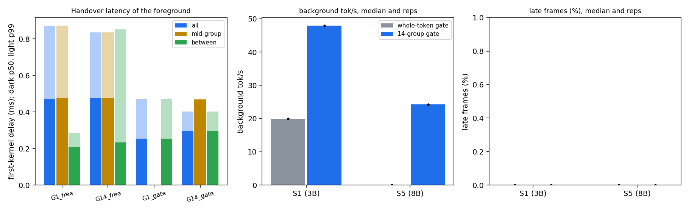

# V2 sprint 2: does pausable decode free the GPU for the real-time app, on hardware?

## Verdict

WIN on throughput, by the decision rule fixed before measuring, and a clear failure of the handover forecast. With the 14-group gate the background decode produced 47.9 tok/s in S1 (3B) where the whole-token gate produced 19.95, and 24.2 tok/s in S5 (8B) where it produced 0.0, with 0.00% late frames in every one of the 12 end-to-end cells (3 reps each). The win is not a late-frame win: the whole-token gate also had 0.00% late frames, because it only ever starts a token that fits, so there was no lateness to cut. The handover forecast in this document was wrong, and section "The handover forecast was wrong" says why.

Branch v2-foreground. Follows docs/V2_SPRINT1_PAUSE_COST.md, which measured what a pause costs the decode (2.2% at 14 groups, longest group 1.95 ms on the 3B). This document was written in the order the work was done: the forecast and the decision rule below were committed (09a0cd0) before any measurement.

## Questions and decision rule (fixed before measuring)

1. Handover latency: how long does the foreground's first kernel wait behind the decode, for whole-token decode (G = 1) against 14 groups (G = 14), when the decode is between groups and when it is mid-group?
2. The 8B group profile: the longest group at G = 1, 14 and 28.
3. End to end, on hardware: S1 (3B) and S5 (8B), gate on, 60 s cells, 3 reps, whole-token gate (the v1 behaviour) against the 14-group pausable gate, with tok/s, late-frame % and power from the energy counter.

Decision rule for question 3:

- WIN: the 14-group gate cuts late frames against the whole-token gate in S5 with no loss in tok/s, or raises tok/s with late frames no worse.
- NEUTRAL: the difference is within noise.
- LOSS: worse on both.

Which one applies: WIN, through the second clause (tok/s up, late frames no worse: 0.00% against 0.00%). The first clause (cutting late frames) cannot be tested here because the baseline arm already has none. "Within noise" was defined in the analysis as a difference smaller than the larger rep-to-rep range of the two arms; the throughput differences are 100 times larger than that range.

## Forecast (committed before measuring)

Stated forecast for handover latency (from the brief): with whole-token decode the worst wait for the foreground's first kernel is about one token (about 10 ms); with 14 groups it is about one group (about 2 ms) plus the WDDM context switch (0.15 to 0.37 ms). For the 8B I expect the output head to be larger than the 3B's 1.3 ms, so the longest group at G = 28 should be above 2.5 ms, and G = 14 around 3 to 4 ms (an 8B layer is about 0.65 ms, from the 3B's per-layer time scaled by size, and the head about 1.8 ms because the vocabulary projection is 4096 wide instead of 3072 for the same 128k vocabulary).

A competing hypothesis, recorded so the result can be read against it: the earlier time-slice measurements (q = 0.374 ms, s = 0.148 ms, docs/W2_SUMMARY.md) show that the GPU switches between contexts every quantum, so a foreground kernel submitted while a decode graph is running may start within about one quantum whatever the group length, and the cost shows up as a slower frame (about 2.8 times longer when both have work) rather than as a long wait. If that holds, the first-kernel delay will be similar for G = 1 and G = 14 (a few tenths of a millisecond), and the benefit of groups will only appear through the gate: the decode can stop launching work when a frame is due, which whole-token decode cannot do for a token that does not fit.

For the end-to-end cells: in S1 most tokens of the 3B fit the slack and I expect little difference (within a few percent in tok/s, late frames near zero for both). In S5 the 8B token (about 21 ms) never fits a gap, so the whole-token gate should produce about 0 tok/s with 0% late frames, and the 14-group gate should produce a few to ten tok/s; the late-frame effect is the open question, since the v1 governor's late frames in S5 came from interleaving costs under time-slicing that the simulator does not model.

## Method, in brief

Foreground: the v1 synthetic 60 fps loop (FMA kernels, the evaluation's scene cost factors, 7 ms nominal at 1800 MHz) in one process, publishing the frame hint live. Background: the patched llama.cpp decode of sprint 1, in a second process, gated on that hint: per token for G = 1 (the v1 rule, the clean-estimate median of the last 8 tokens, start only if the app is idle and now + estimate + guard is before the next deadline) and per layer group for G = 14 (one estimate per group index, the hint read before every group launch). Both arms use guard 0 ms, the registered v1 static setting (1800_a_g0_d1), a fixed 1800 MHz lock, 5 s warm-up and a 60 s measured window, power from two energy-counter reads and a guarded sampled-power stream. Handover cells put a tiny marker kernel (reads %globaltimer) in front of every foreground frame; its start on the GPU clock, mapped to host time, minus the host time just before the launch is the first-kernel delay. The GPU timer drifts against the host clock by about 70 microseconds per second, so the mapping uses two idle calibrations per cell with a linear offset between them; an idle round trip is 7 microseconds. Code: `workloads/background/llama_handover_bench.cpp`, `tools/handover_cell.py`, `tools/handover_analyze.py`; data: `data/v2/s2/` and `data/v2/s1_pause/20261107T220932Z/`.

## Measured

### Step 0: the 1500 MHz lock, read back

G = 1 and G = 14, 300 tokens each at the 1500 MHz lock: nvidia-smi (every 100 ms) read 1500 MHz in all 60 samples of each run, NVML read 1500 MHz in all 1,445 and 1,459 samples, `power_rejected` was 0. This is also recorded in docs/V2_SPRINT1_PAUSE_COST.md.

### The handover forecast was wrong, and why

The forecast said a foreground frame submitted while a whole token is running waits about one token (about 10 ms), against about one group (about 2 ms) plus the context switch for 14 groups. Measured at 1800 MHz with free-running decode, 2 reps of 60 s, 7,200 foreground frames per configuration, first-kernel delay in milliseconds:

| decode | state at the foreground's submit | share of frames | n | p50 | p99 | max |
|---|---|---|---|---|---|---|
| whole token (G = 1), free | mid-token | 93% | 6,172 | 0.477 | 0.874 | 1.69 |
| whole token (G = 1), free | between tokens | 7% | 440 | 0.208 | 0.285 | 0.305 |
| 14 groups, free | mid-group | 89% | 6,193 | 0.477 | 0.835 | 1.47 |
| 14 groups, free | between groups | 11% | 750 | 0.233 | 0.853 | 1.59 |
| whole token, gated by the hint | decode waiting (nothing running) | 100% | 7,200 | 0.254 | 0.471 | 1.57 |
| 14 groups, gated by the hint | between groups, waiting | 100% (2 frames mid-group) | 7,198 | 0.297 | 0.402 | 1.20 |

The whole-token worst case was not about 10 ms: the maximum over 6,172 frames submitted mid-token was 1.69 ms and the p99 0.87 ms. The group number was not better either: the mid-group median is 0.477 ms in both rows. The 14-group figure sits inside its forecast bound (about 2 ms plus the switch) only because the whole-token figure is already that small. Cutting a token into groups did not change how long the foreground waits.

Why. The forecast treated a running decode graph as something the foreground has to wait behind. WDDM does not work that way: it time-slices between processes with a quantum of about 0.37 ms and a switch gap of about 0.15 ms (docs/W2_SUMMARY.md, measured in sprint W2), so a foreground kernel starts within about one quantum plus a switch whatever the length of the decode graph. The measured median of 0.477 ms is of that order (0.374 + 0.148 = 0.52 ms). The foreground does not wait for the token to finish; it shares the GPU, and the cost shows up as a slower frame. The free-running cells show that cost directly: with decode free-running next to the 7 ms foreground frame, 100% of frames were late and the loop fell behind by seconds (p99 latency 6.5 s with 14 groups and 9.6 s with whole tokens), because a frame that is stretched by about 2.8 times takes 19.6 ms, longer than the 16.7 ms period. Both are in the sprint-2 data (`exp1_handover`). The benefit of pausing is therefore not a faster handover. It is less overlap, and that is what the end-to-end cells measure.

A further observation, not a forecast: when decode is idle or waiting, the first-kernel delay still has a floor of 0.21 to 0.30 ms (the "between" and gated rows), far above the idle round trip of 7 microseconds measured before the cell started. A plausible reading is the cost of switching the GPU back to the foreground's context once another context exists (the 0.148 ms switch gap plus scheduling); I did not test it.

### The 8B group profile

3 reps of 300 tokens at the 1500 MHz lock, patched llama.cpp, Llama-3.1-8B Q4_K_M:

| G | token time | overhead against G = 1 | longest group (median, p99) |
|---|---|---|---|
| 1 | 21.01 ms | 0% | 21.01 ms |
| 14 | 21.32 ms | 1.4% | 3.61 ms (3.74) |
| 28 | 21.62 ms | 2.9% | 2.99 ms (3.08) |

A layer takes about 0.63 ms (the first groups at G = 28), and the output projection takes about 2.4 ms (the last group minus its layers: 2.99 - 0.63 at G = 28, 3.61 - 1.25 at G = 14), against 1.3 ms for the 3B and the 1.8 ms I forecast. The forecast of the longest group was right in kind (G = 14 in the 3 to 4 ms band, G = 28 above 2.5 ms) but the head was underestimated. For the 8B no G up to 28 reaches the 2.5 ms limit of sprint 1; the floor at layer granularity is about 3 ms, set by the head. Splitting the head by rows would lower it and was not tried.

### End to end: whole-token gate against the 14-group gate

12 cells, 60 s measured windows after a 5 s warm-up, 1800 MHz lock (SM clock median 1800 MHz in every cell), guard 0 ms, `power_rejected` 0 in all 12. Medians over 3 reps, reps in brackets (the reps are within 0.2 tok/s of each other):

| scene | gate | tok/s | late frames | power (energy counter) | J per token |
|---|---|---|---|---|---|
| S1, 3B | whole token (v1) | 19.95 [19.9, 19.9, 20.0] | 0.00% | 41.7 W | 2.09 |
| S1, 3B | 14 groups | 47.9 [48.0, 47.9, 47.8] | 0.00% | 57.9 W | 1.21 |
| S5, 8B | whole token (v1) | 0.0 [0.0, 0.0, 0.0] | 0.00% | 31.7 W | not defined |
| S5, 8B | 14 groups | 24.2 [24.2, 24.2, 24.2] | 0.00% | 59.2 W | 2.44 |

Sanity check on the baseline: the whole-token gate in S1 gives 19.95 tok/s here, and the registered v1 static aligned setting gave 19.97 tok/s in S1 (docs/W5B_RESULTS.md and data/w5b/eval_descriptive.md), so this arm reproduces the v1 behaviour. The 14-group arm draws 57.9 to 59.2 W, just under the 60 W budget of the evaluation; this gate has no power control, so that is where the decode lands at 1800 MHz.

Per frame, over the 10,800 measured frames of each arm (3 reps), the two numbers that explain the late-frame result. The overlap is the decode group time (host launch to host completion, a proxy for GPU activity that includes launch and sync latency) falling inside the frame's execution; the slowdown is the frame's duration against its solo duration, taken as the median duration per unit of nominal cost over the frames in the same cell that no decode touched.

| scene | gate | frames touched by decode | overlap per touched frame (mean, max) | slowdown of touched frames (p50, p99) | late frames |
|---|---|---|---|---|---|
| S1 | whole token | 0.2% | 1.92 ms, 6.47 ms | 1.18, 1.79 | 0 |
| S1 | 14 groups | 0.1% | 1.03 ms, 7.08 ms | 1.00, 1.08 | 0 |
| S5 | whole token | 0.0% (no token ever started) | none | not defined | 0 |
| S5 | 14 groups | 0.2% | 0.15 ms, 0.75 ms | 1.01, 1.05 | 0 |

Reading. Almost no frame is touched by decode in either arm (a few tens of frames in 10,800), because both gates keep decode out of the frame. For the rare frame that is touched, the whole-token gate lets a whole token overlap it (up to 6.5 ms of decode, slowdown up to 1.79 at p99), while the 14-group gate keeps the overlap to a group or two and the frame is barely slowed (p99 1.08). No frame was late in any cell, because the frame costs of S1 and S5 leave 9 to 12 ms of slack even for a stretched frame. So pausing does what it was meant to do, shrinking the overlap per frame, but at these frame costs the shrunken overlap was not needed to avoid lateness, and what it bought was the gaps: with groups of 0.7 ms (3B) or 1.2 ms (8B) the decode can use slack that a 10 ms or 21 ms token cannot. The maximum overlap of 7.08 ms for one 14-group frame next to a slowdown of 1.08 at p99 shows the limits of the host-side overlap proxy (several short groups can fall inside one long frame), and I did not investigate that frame.

### First run, kept for the record (superseded)

The first end-to-end run used a gate that slept for 1 ms between hint checks and a 0.5 ms guard. It gave the whole-token gate 1.5 tok/s in S1 against 20.7 for 14 groups (and 0.0 against 9.3 in S5), all with 0.00% late frames. That run is superseded: the whole-token gate has only a window of about 1 ms after each light frame in which a 10.1 ms token fits (5 ms frame, 10.1 ms token, 0.5 ms guard, 16.7 ms period), and a sleep that wakes every 1.5 to 2 ms sleeps through most of those windows. The v1 driver spins while it waits and its static setting has guard 0; the rerun does the same (spin, guard 0) and the S1 whole-token arm then reproduces v1 (19.95 against 19.97 tok/s). The data of the first run is kept (`*_first_run_sleep1_guard0.5`). It is still a finding in itself: a whole-token gate needs precise waiting to use even the windows that exist, and the 14-group gate, with many short windows, was far less sensitive to it: between the first run and the corrected run the 14-group arm in S1 moved from 20.7 to 47.9 tok/s (2.3 times), the whole-token arm from 1.5 to 19.95 (13 times).

### Plot

Left: first-kernel delay of the foreground by decode configuration and decode state (dark bars p50, light bars p99). Middle and right: background tok/s and late-frame % per scene and gate, medians with the three reps as dots. File: `data/v2/s2_handover.png`.

## Limitations

- Late frames were 0.00% in both arms of every end-to-end cell, so the effect of pausing on lateness was not tested in a regime where the baseline misses. The v1 governor's late frames (1.72% in S1, 4.72% in S5) came from its unaligned mode overlapping decode with frames; this sprint compared two aligned gates, which never overlap on purpose. Whether pausable decode would remove the v1 governor's late frames, or let it run aligned instead, was not tested. The registered v1 medians for the governor (S1 19.4 tok/s, 1.72% late; S5 7.8 tok/s, 4.72% late) are not like-for-like with these cells (10 registered blocks and the full executor against 3 reps of a leaner runner), so the numbers here show the size of the effect (47.9 and 24.2 tok/s at 0.00% late) but are not a registered comparison.
- Both arms are static: an aligned gate at 1800 MHz with guard 0, no governor, no power control. The 14-group arm lands at 57.9 to 59.2 W; with a power budget below that the decode would have to be throttled.
- One machine, one GPU and driver, one model per scene, the synthetic compute-bound FMA foreground (a graphics application may be preempted differently), three reps (the reps agree to 0.2 tok/s, as expected for a deterministic synthetic load, so they say little about variability across sessions).
- The handover cells put a marker kernel in front of every frame and use the S0 scene (constant 7 ms), so their late-frame rates are not comparable with the end-to-end cells. The classification mid-group or between is by host-side intervals; the GPU-to-host clock mapping rests on two idle calibrations and a linear drift model (drift about 70 microseconds per second). Delays are positive and the idle round trip is 7 microseconds, but a small residual error in the mapping (tens of microseconds) cannot be excluded.
- The explanation of the handover result (the WDDM quantum) is consistent with the data and the earlier W2 measurements but was not tested by varying the quantum; the 0.2 to 0.3 ms floor when decode is idle is unexplained (a context-switch reading is a hypothesis).
- The overlap per frame is a host-side proxy for GPU activity, and the solo duration is estimated from untouched frames of the same cell, not from a separate foreground-only run.
- The gate spins on the CPU while it waits, as the v1 driver does; the CPU and power cost of spinning was not separated from the GPU power.
- The patched llama.cpp is a local copy with about 65 changed lines, not upstream; graph re-capture when the padded KV length changes was not exercised at length, and the context was 6144 tokens, longer than the 2048 of the v1 driver, which changes attention cost slightly.
- Measurement discipline: the clock helper and an idle GPU were confirmed before the runs, no browser or tray processes were running, the lock was read back (step 0), and the armoury mode was not recorded.
