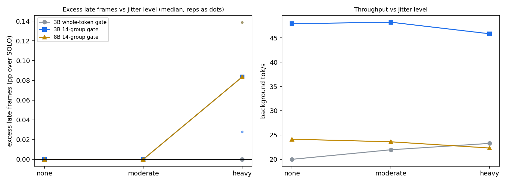

# V2 sprint 3: does the pausable gate keep frames on time when the app is not perfectly regular?

## Verdict

PASS by the decision rule fixed before measuring; no OVERLAP BONUS; no FAIL. With jitter the 14-group gate added 0.00 percentage points of late frames over the app's own at the moderate level and 0.08 at the heavy level (reps +0.03, +0.08, +0.14), against limits of 1 and 2, while delivering 48.2 and 45.9 tok/s against 21.9 and 23.3 for the 3B whole-token gate. The overlap bonus did not happen, and the small difference ran the other way: the whole-token gate had 0.00 excess late frames at heavy, the 14-group gate 0.08, because jitter makes the group gate touch many more frames (35% against 8%) and a few of those touches tip a frame over. The effect is about a tenth of a percentage point, close to the run-to-run noise of this design, and almost all late frames (97%) are the app's own, mostly its cost spikes.

Branch v2-foreground. Follows docs/V2_SPRINT2_HANDOVER.md, which showed that the 14-group gate delivers 2.4 times (3B) and infinitely more (8B) throughput than the whole-token gate with 0.00% late frames, on a perfectly regular foreground.

Branch v2-foreground. Follows docs/V2_SPRINT2_HANDOVER.md, which showed that the 14-group gate delivers 2.4 times (3B) and infinitely more (8B) throughput than the whole-token gate with 0.00% late frames, on a perfectly regular foreground. This document is written in the order the work was done: the hint semantics, the decision rule and the forecast below were committed before any measurement.

## What the gate knows, and when (hint semantics)

The foreground publishes three things through the 40-byte record: a busy flag, the next deadline and the time of the update. Busy goes up before a frame (in the v1 loop 1 ms before the frame's scheduled arrival, not at the real submit), and goes down when the frame has actually finished, with the next deadline in both updates equal to the nominal arrival of the next frame on the fixed 60 Hz grid (scheduled time plus 16.67 ms), so the gate learns that a frame has ended only after it has ended. It is never told a frame cost or a frame's expected end, never told when a frame will really be submitted if that differs from the grid, and never told about GPU work the app does outside its frames. The gate itself keeps only its own estimate of how long a decode unit takes (the median of the last 8 clean durations, one per group index) and starts a unit only if the app is not busy and now plus that estimate plus the guard (0 ms here) is before the published deadline. Consequences for what a jitter test can stress. Frame-cost variation is mostly seen by the gate: a long frame simply keeps busy up longer, and the gate is told when it ends, so cost jitter alone does not test the gate; it shrinks the margin of frames that decode does touch and it raises the solo lateness. Submit-time jitter is not seen: the deadline the gate trusts is the nominal grid, so a frame that arrives up to 2 ms early collides with a unit the gate believed would end in time, and the busy flag now goes up only at the real submit. Unannounced bursts (a compositor or UI pass in the gap) are not seen at all: they occupy the GPU while the hint says the gap is free. The effects to watch are therefore from submit jitter and bursts; cost jitter is the baseline against which they show.

## Questions and decision rule (fixed before measuring)

Jitter on the synthetic 60 fps foreground, seeded, with the same seed and the same frame sequence across the arms of a level and repetition. Three kinds: (a) frame cost lognormal around the current scene mean with a coefficient of variation of 0.15 (moderate) or 0.30 (heavy), plus a 2x spike in 2% of frames (heavy only); (b) submit time off the schedule by up to plus or minus 1 ms (moderate) or 2 ms (heavy), with the hint updated only when the app actually submits; (c) an unannounced extra kernel of 0.5 to 1.5 ms at a random point in the gap before a frame, in 5% (moderate) or 10% (heavy) of frames, with no hint. Arms at 1800 MHz, guard 0, spin-wait as in sprint 2: SOLO (app only, no decode), 3B whole-token gate, 3B 14-group gate, 8B 14-group gate (the 8B whole-token gate gives 0 tok/s and is skipped). Levels: none (1 rep, a reproduction check against sprint 2), moderate and heavy (3 reps each); 60 s measured cells; 28 cells.

Excess late % of an arm at a level is its late-frame % minus the SOLO late-frame % at the same level (same seeds). Decode must not be blamed for lateness the app has on its own.

- PASS: the 14-group excess late is at most 1 percentage point at moderate and at most 2 at heavy, with tok/s at least that of the whole-token gate at the same level.
- OVERLAP BONUS: the 14-group excess late is below the whole-token excess late at heavy. This would be the first late-frame win from pausing; the document says whether it happened.
- FAIL: the 14-group excess late is above 5 percentage points at moderate.

Every late frame is classified as solo-caused (the SOLO cell with the same seed misses the same frame, matched by sequence index), decode-overlap (decode work overlapped it, with the overlap in ms), burst-caused (an unannounced burst in the gap before it plus decode overlap), or other (none of these). The slowdown distribution of the frames decode touched is reported per arm as in sprint 2.

## Forecast (committed before measuring)

SOLO late frames: none 0%, moderate about 0.2%, heavy about 3% (the heavy cost spikes at the 1.3x phase of S1 are 18 ms frames, and lognormal tails with a CV of 0.30 add to that). Excess late frames, 14 groups: about 0.2% at moderate (range 0 to 1) and about 0.8% at heavy (range 0.2 to 2), because the gate keeps almost all decode work out of the frames and what remains is the group in flight when an early or bursting frame arrives, at most about 1 ms for the 3B (a group is 0.7 ms) and about 1.2 ms for the 8B. Excess late frames, whole token: about 0.3% at moderate and 1.0% at heavy, because the tail of a token that the gate admitted can overlap a frame that arrives up to 2 ms early, and a whole token has a longer tail than a group. So I expect PASS at both levels and I do not expect FAIL (an excess above 5 points would need decode to overlap a large share of frames). OVERLAP BONUS: I give it a little under even odds; the expected difference between the arms is a few tenths of a percentage point, close to what three reps can resolve. Throughput: the whole-token gate loses windows when frame cost and submit time vary (its window is about 1 ms wide), so I expect it to fall from 19.95 tok/s (none) to roughly 10 to 15 at heavy, and the 14-group gate to stay near 40 to 48 tok/s. Cause breakdown: at heavy most late frames should be solo-caused (cost spikes), the decode-overlap share small, and the burst-caused share the largest part of the excess.

## Forecast vs measured

| quantity | forecast | measured |
|---|---|---|
| SOLO late frames, moderate | about 0.2% | 0.00% (all 3 reps) |
| SOLO late frames, heavy | about 3% | 1.31% (1.17, 1.36, 1.31) |
| 14-group (3B) excess late, moderate | about 0.2 pp (0 to 1) | 0.00 pp |
| 14-group (3B) excess late, heavy | about 0.8 pp (0.2 to 2) | 0.08 pp (0.03, 0.08, 0.14) |
| whole-token (3B) excess late, moderate / heavy | about 0.3 / 1.0 pp | 0.00 / 0.00 pp (every rep) |
| decision rule | PASS at both levels, no FAIL | PASS at both levels, no FAIL |
| OVERLAP BONUS | a little under even odds | did not happen (whole 0.00 pp, 14-group +0.08 pp) |
| whole-token tok/s at heavy | falls from 19.95 to about 10 to 15 | 23.3 (it rose; 20.0 at none, 21.9 at moderate) |
| 14-group tok/s at heavy | near 40 to 48 | 45.9 (3B), 22.3 (8B) |
| main source of the excess | bursts | submit-time jitter: 10 of the 11 decode-attributed late frames of the 3B group arm had no burst |

What the forecast got right: the verdict (PASS, no FAIL), the throughput of the 14-group gate and the dominance of the app's own late frames. What it got wrong: it overestimated every lateness number (SOLO heavy 1.31% against about 3%, 14-group excess 0.08 against 0.8, whole-token excess 0.00 against 1.0), it expected the whole-token gate to lose throughput under jitter when it gained some (cost variation sometimes makes a frame short enough that a token fits, so the windows the whole-token gate needs open more often than they close), and it expected bursts, not early submits, to be the main source of the decode-attributed late frames. The 'none' level reproduces sprint 2 (whole 20.0, 14-group 47.9, 8B 24.1 tok/s, 0.00% late; sprint 2 had 19.95, 47.9 and 24.2).

## Table: tok/s, late %, excess late %, power per arm and level

1800 MHz lock, guard 0, spin-wait, 60 s measured windows (10,800 frames per arm and level at moderate and heavy, 3,600 at none), power from the energy counter, `power_rejected` 0 in all 28 cells, SM clock median 1800 MHz in all cells. Medians over reps, reps in brackets; excess late is the arm's late % minus the SOLO late % of the same level and rep.

| level | arm | tok/s | late % | SOLO late % | excess late (pp) | power |
|---|---|---|---|---|---|---|
| none (1 rep) | SOLO | 0.0 | 0.00 | 0.00 | 0.00 | 29.0 W |
| none | 3B whole token | 20.0 | 0.00 | 0.00 | 0.00 | 41.4 W |
| none | 3B 14 groups | 47.9 | 0.00 | 0.00 | 0.00 | 58.3 W |
| none | 8B 14 groups | 24.1 | 0.00 | 0.00 | 0.00 | 60.3 W |
| moderate | SOLO | 0.0 | 0.00 | 0.00 | 0.00 | 30.8 W |
| moderate | 3B whole token | 21.9 [21.9, 21.8, 22.7] | 0.00 | 0.00 | 0.00 | 43.9 W |
| moderate | 3B 14 groups | 48.2 [48.3, 48.1, 48.2] | 0.00 | 0.00 | 0.00 | 58.4 W |
| moderate | 8B 14 groups | 23.6 [23.6, 23.6, 23.6] | 0.00 | 0.00 | 0.00 | 58.7 W |
| heavy | SOLO | 0.0 | 1.31 [1.17, 1.36, 1.31] | 1.31 | 0.00 | 31.2 W |
| heavy | 3B whole token | 23.3 [23.6, 22.6, 23.3] | 1.31 [1.17, 1.36, 1.31] | 1.31 | 0.00 [0, 0, 0] | 44.4 W |
| heavy | 3B 14 groups | 45.9 [45.9, 45.9, 45.8] | 1.44 [1.19, 1.44, 1.44] | 1.31 | 0.08 [0.03, 0.08, 0.14] | 57.6 W |
| heavy | 8B 14 groups | 22.3 [22.3, 22.3, 22.3] | 1.44 [1.25, 1.44, 1.44] | 1.31 | 0.08 [0.08, 0.08, 0.14] | 57.2 W |

Decision rule: moderate, 14-group excess 0.00 pp (limit 1) with 48.2 tok/s against 21.9 for the whole-token gate: pass. Heavy, 0.08 pp (limit 2) with 45.9 against 23.3: pass. FAIL (excess above 5 pp at moderate): no. OVERLAP BONUS (14-group excess below whole-token excess at heavy): no, 0.08 against 0.00. The 8B arm has no whole-token counterpart (it produces 0 tok/s); its median excess equals the 3B group arm's (0.08 pp; pooled over the reps 0.10 against 0.08). The 14-group gate draws 57 to 60 W; at 'none' the 8B arm read 60.3 W, just above the 60 W budget of the evaluation, and the gate has no power control.

## Late-frame cause breakdown

Every late frame of an arm cell is matched by sequence index to the SOLO cell of the same level and rep (the same seed, so the same cost, submit and burst sequence). Pooled over the 3 reps at the heavy level, 10,800 measured frames per arm; the SOLO cells have 138 late frames pooled. At none and moderate no arm had a late frame, so there is nothing to classify.

| arm (heavy) | late frames | solo-caused | burst + decode | decode overlap | other | solo-late frames that were on time here | mean decode overlap of the decode-attributed frames |
|---|---|---|---|---|---|---|---|
| 3B whole token | 138 | 133 | 3 | 0 | 2 | 5 | 7.68 ms (n = 3) |
| 3B 14 groups | 147 | 135 | 1 | 10 | 1 | 3 | 1.45 ms (n = 11) |
| 8B 14 groups | 149 | 136 | 2 | 9 | 2 | 2 | 2.57 ms (n = 11) |

Net against SOLO: whole token 138 - 5 + 5 = 138 (excess 0); 3B 14 groups 138 - 3 + 12 = 147 (excess 9 frames, 0.08 pp); 8B 138 - 2 + 13 = 149 (excess 11 frames, 0.10 pp). Of the 138 SOLO late frames themselves, 64 are the 2x spike frames, 65 are frames with a cost above 9 ms (the lognormal tail at the 1.3x phase), 6 are burst frames and 3 have no obvious cause, so the app's own cost jitter explains 93% of them.

Reading. The decode-attributed late frames are few (3 to 13 in 10,800) and the noise floor of this design is of the same order: 'other' (late with no solo lateness, no decode overlap and no burst) and 'solo-late frames that were on time here' are 2 to 5 per arm, so any single arm can gain or lose that many frames by timing alone. What is attributable to decode by overlap is: 3 frames for the whole-token gate (each with a burst, mean overlap 7.7 ms, a whole token's tail), 11 for the 3B group gate (10 of them with no burst, mean overlap 1.45 ms) and 11 for the 8B group gate (mean overlap 2.6 ms). So the group gate does less damage per touch and touches far more frames, and the second effect wins by a few frames. The cause is submit-time jitter, not bursts: the gate trusts the nominal deadline, a frame that arrives up to 2 ms early finds a group that the gate believed would end in time, and a burst-free overlap results.

Slowdown of the frames decode touched (duration of the frame divided by the duration of the same frame in the SOLO cell; a matched ratio), pooled over reps:

| level | arm | frames touched by decode | slowdown p50 | slowdown p99 |
|---|---|---|---|---|
| none | 3B whole / 3B 14 groups / 8B 14 groups | 10 / 4 / 29 of 3,600 | 1.01 / 1.00 / 1.01 | 1.34 / 1.16 / 1.06 |
| moderate | 3B whole token | 554 of 10,800 (5.1%) | 1.01 | 1.83 |
| moderate | 3B 14 groups | 2,849 (26.4%) | 1.05 | 1.23 |
| moderate | 8B 14 groups | 1,689 (15.6%) | 1.07 | 1.34 |
| heavy | 3B whole token | 845 (7.8%) | 1.11 | 2.15 |
| heavy | 3B 14 groups | 3,750 (34.7%) | 1.08 | 1.47 |
| heavy | 8B 14 groups | 3,014 (27.9%) | 1.14 | 1.67 |

Without jitter decode touched 0.1% to 0.8% of frames. With jitter it touches 16% to 35% of frames for the group gate and 5% to 8% for the whole-token gate: the gate's picture of the gap is wrong whenever a frame arrives early or a burst fills the gap, and it launches into it. The group gate's touches are short (slowdown p99 1.2 to 1.7) and the whole-token gate's are rarer but longer (p99 1.8 to 2.2), which is the pausing benefit showing up as a smaller worst case per touched frame. At these frame costs (a 5 to 9 ms frame in a 16.7 ms period) neither kind of touch usually costs a deadline, which is why the late-frame numbers barely move.

## Plot

Left: excess late frames (percentage points over SOLO) against jitter level for each arm; the line is the median and the dots are the reps (the 3B whole-token arm is 0.00 in every rep and lies on the axis). Right: background tok/s against level. File: `data/v2/s3_jitter.png`. The excess axis spans 0.14 pp: the whole difference between the arms is smaller than the 1 and 2 percentage-point limits by more than a factor of ten.

## Limitations

- The late-frame margin is large: S1 and S5 frames cost 5 to 9 ms in a 16.7 ms period, so decode touching a frame rarely costs the deadline. The test shows that the gate does not turn jitter into late frames at these costs; it does not show what happens with an app that has little slack (a 12 to 14 ms frame), where a 1 to 2 ms overlap would matter. That is the regime where the group gate's smaller per-touch damage, or its far larger number of touches, could change the sign of the result, and it was not tested.
- The excess of 0.08 pp is about 9 frames in 10,800 and the noise floor of the design (frames that flip without decode overlap) is 2 to 5 frames per arm, so the sign of the whole-token against group difference rests on three reps and on the classification by overlap; I would not claim the group gate is worse, only that it was not better.
- Late frames are measured against the nominal schedule, so submit-time jitter counts as lateness in every arm including SOLO; the SOLO subtraction removes it from the excess but not from the late-frame percentages. At heavy, SOLO itself misses 1.31% of frames.
- The jitter model is synthetic and independent between frames: lognormal cost, uniform submit offset, bursts uniformly placed in the gap before a frame (by construction a burst ends 0.3 ms before the frame's planned submit when the GPU is free, so it delays the frame only if decode stretches it, and otherwise acts on the gate's picture of the gap). Real apps have correlated cost (a heavy scene lasts many frames), submit times tied to a vsync or a compositor, and work that overlaps frames; none of that was modelled. Bursts here are FMA kernels on the same stream as the frame, issued by the foreground thread.
- The decode-overlap measure is a host-side proxy (group launch to host completion) for GPU activity, and the matched slowdown assumes that a frame has the same duration in the SOLO cell as in the arm cell apart from decode (true by construction for cost, not for GPU clock or thermal state, which stayed at 1800 MHz).
- Three reps per level, one machine, one GPU and driver, one clock, the S1 foreground for every arm (the S5 foreground is the S1 loop, so the 8B arm shares the SOLO baseline). The 'none' level has one rep and is a reproduction check only.
- The gate has no power control: the 14-group arm draws 57 to 60 W, and the 8B arm read 60.3 W at 'none', just above the 60 W budget of the evaluation.
- The gate spins on the CPU while waiting, as in sprint 2; the CPU and power cost of spinning was not separated.
- Measurement discipline: the clock helper and an idle GPU were confirmed before the matrix, no browser or tray processes were running, `power_rejected` was 0 in all 28 cells, the SM clock median was 1800 MHz in every cell, and the armoury mode was not recorded.
