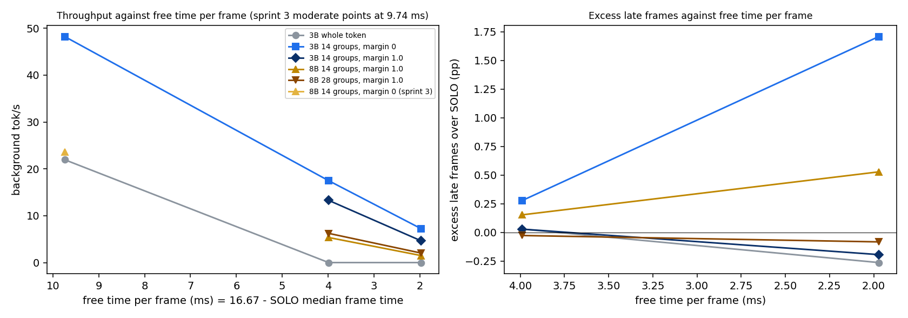

# V2 sprint 4: does pausable decode still help when the app leaves little free time per frame?

## Verdict

PASS at both slack levels by the decision rule fixed before measuring, MARGIN WORKS: no, FAIL: no. The PASS arm is the 3B 14-group gate with guard 0: excess late frames over the app's own of +0.28 percentage points at TIGHT (3.99 ms free per frame) with 17.5 tok/s, and +1.71 pp at VERY TIGHT (1.97 ms free) with 7.2 tok/s, while the whole-token gate gets 0 tok/s at both. The forecast was wrong about which arm passes: I expected guard 0 to miss its limits (+2 and +6 pp) and the guard-1.0 arm to be the one that passes; guard 0 passes, and by a wide margin at TIGHT. At VERY TIGHT the pass rests on the median of two reps: rep 1 is +2.28 pp, above the 2 pp limit, and rep 2 is +1.14. The margin does what it is for and costs more than the rule allows: guard 1.0 cuts the decode-attributed late frames from 21 to 2 (TIGHT) and from 80 to 3 (VERY TIGHT) but keeps only 76% and 64% of the throughput (the rule allows a loss of 15%). The 8B collapses at VERY TIGHT as forecast (1.5 to 2.0 tok/s against 24 in the regular case) and still works at TIGHT (5 to 6 tok/s). Decode is not what makes frames late in this regime: the app misses 3.85% (TIGHT) and 29.3% (VERY TIGHT) of its own frames before any decode runs.

Branch v2-foreground. Follows docs/V2_SPRINT3_JITTER.md (PASS under moderate and heavy jitter with 8 to 11 ms of slack per frame). This document is written in the order the work was done: the step-0 finding, the decision rule and the forecast below were committed and pushed before any measurement.

## Step 0 finding: per-group prediction, and what the margin is

The gate already predicts each group's own duration. In `workloads/background/llama_handover_bench.cpp` the gate keeps one estimator per group index (`g_est`, one entry per group), each the median of that group's last 8 clean durations (a duration is clean if the unit ended before the deadline it was gated against), falling back to an exponentially weighted average (0.9 old, 0.1 new) only until the first clean one exists. The output-head group (about 1.3 to 1.9 ms for the 3B, 2.4 to 3.6 ms for the 8B depending on how the layers are grouped) therefore has its own estimate, and the short groups have theirs; no single average is used and nothing was switched. One property worth knowing in tight gaps: a group that overran its deadline is not clean and does not enter the median, so after a run of overruns the estimate can lag the true duration until clean ones return; the average over all units is not used for the decision once a clean one exists. The early-start margin m of the brief is the existing guard of the gate: a unit launches only if now plus its predicted time plus the guard is not after the published deadline, and the guard is applied before every group and before the first group of a token. Sprints 2 and 3 ran it at 0 ms; this sprint runs 0 and 1.0 ms. It is a configuration value (`GUARD_MS`), not a code change in the driver.

## Questions and decision rule (fixed before measuring)

Setup: 1800 MHz lock, spin-wait, 60 fps, moderate jitter ON with the same seeds and model as sprint 3 (frame cost lognormal with a CV of 0.15, submit time within plus or minus 1 ms with the hint updated only at the real submit, 5% unannounced bursts of 0.5 to 1.5 ms), a constant-cost foreground (scene S0 with the nominal cost calibrated). The synthetic frame cost is calibrated so that the SOLO median frame time (frame duration from launch to completion) is 12.5 ms (TIGHT, about 4.2 ms free per frame) or 14.5 ms (VERY TIGHT, about 2.2 ms free per frame); the measured SOLO medians are reported. Arms at each level: SOLO; 3B whole-token gate (guard 0); 3B 14 groups with guard 0; 3B 14 groups with guard 1.0 ms; 8B 14 groups with guard 1.0 ms; 8B 28 groups with guard 1.0 ms. 2 levels x 6 arms x 2 reps = 24 cells of 60 s (5 s warm-up). Excess late % is the arm's late-frame % minus the SOLO late-frame % at the same level and rep (same seed, same sequence).

- PASS: the best 3B group arm has excess late over SOLO of at most 1 percentage point at TIGHT and at most 2 at VERY TIGHT, with tok/s at least that of the whole-token gate. The whole-token gate cannot start a 10 ms token in a 4 ms gap, so its tok/s will be 0 and "at least the whole-token gate" is vacuous; I therefore add a condition before measuring: the arm must also deliver at least 5 tok/s (about a tenth of the regular case), and I report the literal rule and the stricter one separately. "Best" means the 3B group arm with the highest tok/s among those that meet the excess limit.
- MARGIN WORKS: guard 1.0 ms cuts the decode-attributed late frames against guard 0 at the same level (3B, 14 groups) without losing more than 15% of tok/s. Answered yes or no per level.
- FAIL: the best 3B group arm has excess late above 5 percentage points at TIGHT.

Every late frame is classified as solo-caused (the SOLO cell with the same seed misses the same frame), burst plus decode (a burst ran in the gap before it and decode overlapped it), early submit (decode overlapped it and the overlap is no more than the amount by which the frame was submitted ahead of its nominal time plus 0.3 ms: the gate's picture of the deadline was right but the frame came early), decode overlap (any other decode overlap: a group longer than predicted or launched too late), or other. The slowdown of the frames decode touched is the frame's duration divided by the same frame's duration in the SOLO cell.

## Forecast (committed before measuring)

SOLO late frames: about 3% at TIGHT and about 17% at VERY TIGHT, because lognormal frame costs with a CV of 0.15 around 12.5 ms exceed 16.7 ms in about 2.4% of frames and around 14.5 ms in about 16% (the submit jitter adds to both). Free time per frame varies a lot from frame to frame (the standard deviation of the frame time is about 1.9 ms), so a gate that needs a contiguous gap for each group will use only part of the mean free time.

| arm | TIGHT tok/s | TIGHT excess late | VERY TIGHT tok/s | VERY TIGHT excess late |
|---|---|---|---|---|
| SOLO | 0 | 0 (reference, about 3% late) | 0 | 0 (reference, about 17% late) |
| 3B whole token | 0 | 0 (never starts a token) | 0 | 0 |
| 3B 14 groups, guard 0 | about 20 (14 to 24) | about +2 pp (0.5 to 5) | about 6 (2 to 10) | about +6 pp (2 to 12) |
| 3B 14 groups, guard 1.0 | about 13 (9 to 17) | about +0.3 pp (0 to 1) | about 1 (0 to 3) | about +0.5 pp (0 to 2) |
| 8B 14 groups, guard 1.0 | about 3 (1 to 6) | about +0.3 pp (0 to 1) | about 0.5 (0 to 1.5) | about +0.2 pp (0 to 1) |
| 8B 28 groups, guard 1.0 | about 5 (2 to 8) | about +0.3 pp (0 to 1) | about 1 (0 to 2) | about +0.2 pp (0 to 1) |

Reasoning in one place. 3B at TIGHT, guard 0: the ideal is the free 4.2 ms per frame divided by the 10.3 ms of decode per token, that is 0.41 tokens per frame or about 24 tok/s at 60 frames per second, less about 10% for the part of each gap too short for the next group. The excess is the groups in flight when an early frame arrives: with guard 0 the gate fills the gap to the nominal deadline, so about half of all frames (those submitted early, by up to 1 ms) meet a group, and a frame that is already near the limit tips over. At VERY TIGHT the 3B head group (about 1.9 ms) barely fits a 2.2 ms mean gap and fits only in the shorter frames, so tok/s falls sharply, and the excess grows because the base frames are already near the deadline. Guard 1.0 removes the early-frame collisions (the group ends at least 1 ms before the nominal deadline, the size of the early offset) but costs 1 ms of every gap: at TIGHT about a quarter of the throughput, at VERY TIGHT the head group (1.9 ms) plus 1.0 ms needs a 2.9 ms gap, which only the shortest frames leave, so the 3B nearly stops. 8B: the head group is 3.6 ms with 14 groups and 3.0 ms with 28, plus 1.0 ms of guard; at TIGHT it fits only in frames shorter than about 12 ms (roughly 40%), at VERY TIGHT only in frames shorter than about 12.7 ms (about 15 to 20%), and a token also needs its other layers placed, so I expect the 8B to collapse at VERY TIGHT (below 1.5 tok/s) as you suggested.

Decision rule forecast: I expect the guard-0 3B arm to miss the 1 pp limit at TIGHT (about 2 pp), so the 3B guard-1.0 arm should be the PASS arm at TIGHT (13 tok/s, which meets the stricter 5 tok/s condition), and no arm to meet PASS at VERY TIGHT under the stricter rule (guard 1.0 delivers about 1 tok/s, guard 0 exceeds 2 pp). MARGIN WORKS: yes on the late-frame side, no on throughput (a loss of about 35% at TIGHT against the 15% allowed), so overall NO at both levels. FAIL: not expected (an excess above 5 pp at TIGHT would need the best arm to be wrong by a lot).

## Step 0 and calibration, as run

Step 0 needed no change to the gate (the finding above stands): the per-group median estimator and the guard were already what the brief asked for.

Calibration (a 10 s SOLO cell with moderate jitter and the sprint-3 seed per round, nominal frame cost c0 scaled until the median frame time was within 0.05 ms of the target): TIGHT took 4 rounds, c0 12.994 ms gave a median of 12.457 ms; VERY TIGHT took 2 rounds, c0 15.104 ms gave 14.473 ms. In the 60 s matrix cells the SOLO median frame times came out 0.2 ms higher than in the calibration cells: 12.68 ms (TIGHT) and 14.70 ms (VERY TIGHT), so the free time per frame is 3.99 ms and 1.97 ms rather than the 4.2 and 2.2 ms of the targets. I did not find the cause of the 0.2 ms difference (the calibration cells are shorter and have a 2 s warm-up).

## Forecast vs measured

| arm | level | forecast tok/s | measured tok/s | forecast excess late | measured excess late |
|---|---|---|---|---|---|
| SOLO late % (reference) | TIGHT / VERY TIGHT | about 3% / 17% | n/a | n/a | 3.85% / 29.3% |
| 3B whole token | TIGHT | 0 | 0.0 | 0 | +0.03 pp |
| 3B whole token | VERY TIGHT | 0 | 0.0 | 0 | -0.26 pp |
| 3B 14 groups, guard 0 | TIGHT | about 20 (14 to 24) | 17.5 | about +2 pp (0.5 to 5) | +0.28 pp |
| 3B 14 groups, guard 0 | VERY TIGHT | about 6 (2 to 10) | 7.2 | about +6 pp (2 to 12) | +1.71 pp |
| 3B 14 groups, guard 1.0 | TIGHT | about 13 (9 to 17) | 13.3 | about +0.3 pp (0 to 1) | +0.03 pp |
| 3B 14 groups, guard 1.0 | VERY TIGHT | about 1 (0 to 3) | 4.6 | about +0.5 pp (0 to 2) | -0.19 pp |
| 8B 14 groups, guard 1.0 | TIGHT | about 3 (1 to 6) | 5.3 | about +0.3 pp (0 to 1) | +0.15 pp |
| 8B 14 groups, guard 1.0 | VERY TIGHT | about 0.5 (0 to 1.5) | 1.5 | about +0.2 pp (0 to 1) | +0.53 pp |
| 8B 28 groups, guard 1.0 | TIGHT | about 5 (2 to 8) | 6.2 | about +0.3 pp (0 to 1) | -0.03 pp |
| 8B 28 groups, guard 1.0 | VERY TIGHT | about 1 (0 to 2) | 2.0 | about +0.2 pp (0 to 1) | -0.08 pp |

What the forecast got right: the throughput of every arm at TIGHT (all inside the forecast ranges), the whole-token gate doing nothing, the margin's effect on throughput (a loss of about a quarter at TIGHT; forecast about a third), MARGIN WORKS being no, FAIL not occurring, and the 8B collapsing at VERY TIGHT. What it got wrong: the SOLO lateness at VERY TIGHT (29.3% against about 17%: the frames sit nearer the deadline than the lognormal arithmetic suggested, and the 0.2 ms the matrix cells added to the median matters when the free time is 2 ms); the excess of the guard-0 arm (+0.28 and +1.71 pp against +2 and +6), which put it inside the PASS limits at both levels and made it, not the guard-1.0 arm, the PASS arm; and the throughput of the guard-1.0 arms at VERY TIGHT (4.6 tok/s for the 3B against about 1, and 1.5 and 2.0 for the 8B at the top edge of the forecast range), because more frames leave a gap of 3 ms or more than I assumed.

## Main table

Two reps pooled per cell (7200 measured frames per arm and level). Excess is the arm's late % minus the SOLO late % at the same rep, averaged over the reps; the per-rep values are in brackets. Power is the registered energy-counter power; none is above 60 W and no sample was rejected by the power guard.

TIGHT (SOLO median frame time 12.68 ms, 3.99 ms free per frame):

| arm | tok/s | late % | excess late (pp) | power (W) |
|---|---|---|---|---|
| SOLO | 0 | 3.85 | 0 | 40.1 |
| 3B whole token | 0.0 | 3.88 | +0.03 (+0.08, -0.03) | 40.2 |
| 3B 14 groups, guard 0 | 17.5 | 4.12 | +0.28 (+0.53, +0.03) | 50.0 |
| 3B 14 groups, guard 1.0 | 13.3 | 3.88 | +0.03 (+0.25, -0.19) | 47.6 |
| 8B 14 groups, guard 1.0 | 5.4 | 4.00 | +0.15 (+0.44, -0.14) | 46.8 |
| 8B 28 groups, guard 1.0 | 6.2 | 3.82 | -0.03 (+0.11, -0.17) | 47.6 |

VERY TIGHT (SOLO median frame time 14.70 ms, 1.97 ms free per frame):

| arm | tok/s | late % | excess late (pp) | power (W) |
|---|---|---|---|---|
| SOLO | 0 | 29.33 | 0 | 43.5 |
| 3B whole token | 0.0 | 29.07 | -0.26 (+0.19, -0.72) | 43.7 |
| 3B 14 groups, guard 0 | 7.2 | 31.04 | +1.71 (+2.28, +1.14) | 47.9 |
| 3B 14 groups, guard 1.0 | 4.6 | 29.14 | -0.19 (+0.22, -0.61) | 46.6 |
| 8B 14 groups, guard 1.0 | 1.5 | 29.86 | +0.53 (+1.28, -0.22) | 45.3 |
| 8B 28 groups, guard 1.0 | 2.0 | 29.25 | -0.08 (+0.69, -0.86) | 47.0 |

Decision rule, applied:

| rule | TIGHT | VERY TIGHT |
|---|---|---|
| PASS, literal (best 3B group arm within +1 / +2 pp, tok/s at least the whole-token gate) | PASS (3B 14 groups, guard 0: +0.28 pp, 17.5 tok/s) | PASS (3B 14 groups, guard 0: +1.71 pp, 7.2 tok/s) |
| PASS, stricter (also at least 5 tok/s) | PASS, same arm | PASS, same arm |
| MARGIN WORKS (guard 1.0 against guard 0, 3B 14 groups; at most 15% tok/s lost) | NO: decode-attributed late frames 21 to 2, tok/s kept 76% | NO: decode-attributed late frames 80 to 3, tok/s kept 64% |
| FAIL (best 3B group arm above +5 pp at TIGHT) | no | n/a |

The VERY TIGHT pass is thin. The guard-0 arm's excess is +2.28 pp in rep 1, over the 2 pp limit, and +1.14 pp in rep 2; it passes on the mean of the two. The guard-1.0 arm is within the limit in both reps and meets the literal rule, but at 4.6 tok/s it misses the stricter 5 tok/s condition, so only guard 0 qualifies under that rule. The choice at VERY TIGHT is between 7.2 tok/s with an excess of about 1.7 pp and 4.6 tok/s with none.

Graceful degradation (the plot below, with the sprint-3 points at 9.7 ms free per frame): the 3B group gate delivers 48.2 tok/s at 9.7 ms free (sprint 3, moderate jitter), 17.5 at 4.0 ms and 7.2 at 2.0 ms. The 8B group gate gives 23.6 at 9.7 ms, then 5.4 and 1.5 tok/s (guard 1.0, 14 groups). Excess late stays under 2 pp for the best arm at every level.

## Cause breakdown

Every late frame in the 2 reps pooled (7200 frames per arm), classified as the brief defines. "Solo" means the SOLO cell with the same seed misses the same frame. "Decode-attributed" is burst plus early plus overlap.

TIGHT:

| arm | late frames | solo | burst + decode | early submit | decode overlap | other | solo-late, on time here |
|---|---|---|---|---|---|---|---|
| 3B whole token | 279 | 257 | 0 | 0 | 0 | 22 | 20 |
| 3B 14 groups, guard 0 | 297 | 261 | 8 | 1 | 12 | 15 | 16 |
| 3B 14 groups, guard 1.0 | 279 | 263 | 2 | 0 | 0 | 14 | 14 |
| 8B 14 groups, guard 1.0 | 288 | 263 | 7 | 0 | 0 | 18 | 14 |
| 8B 28 groups, guard 1.0 | 275 | 261 | 0 | 0 | 0 | 14 | 16 |

VERY TIGHT:

| arm | late frames | solo | burst + decode | early submit | decode overlap | other | solo-late, on time here |
|---|---|---|---|---|---|---|---|
| 3B whole token | 2093 | 2067 | 0 | 0 | 0 | 26 | 45 |
| 3B 14 groups, guard 0 | 2235 | 2080 | 9 | 17 | 54 | 75 | 32 |
| 3B 14 groups, guard 1.0 | 2098 | 2068 | 3 | 0 | 0 | 27 | 44 |
| 8B 14 groups, guard 1.0 | 2150 | 2072 | 8 | 0 | 2 | 68 | 40 |
| 8B 28 groups, guard 1.0 | 2106 | 2066 | 7 | 1 | 1 | 31 | 46 |

What the numbers say:

- Nearly all late frames are the app's own: 257 to 263 of about 280 at TIGHT and 2066 to 2080 of about 2100 at VERY TIGHT are frames SOLO also misses.
- The guard-0 arm adds 21 decode-attributed late frames at TIGHT and 80 at VERY TIGHT. The guard-1.0 arms add 2 to 7 at TIGHT and 3 to 10 at VERY TIGHT. The 1 ms margin removes nearly all of them.
- At VERY TIGHT the guard-0 arm's 54 "decode overlap" frames are the largest class and only 17 are early submits, so most of its collisions are not explained by frames arriving early. The gate launched a group that ran longer than predicted, or started in a gap the frame then took back; I did not separate the two.
- "Other" (late, not late in SOLO, no decode touch) is 14 to 22 frames at TIGHT and 26 to 75 at VERY TIGHT. The whole-token cell, which runs no decode, has 22 and 26, so this class is mostly timing noise and the whole-token cell sets its floor. The 3B guard-0 arm (75) and the 8B 14-group arm (68) sit above that floor at VERY TIGHT, which I cannot attribute to decode with this classification.
- The SOLO-late frames that are on time in an arm (14 to 20 at TIGHT, 32 to 46 at VERY TIGHT) are the same noise in the other direction. The excess is a difference of counts of a few tens of frames, so I read it as good to about 0.5 pp at VERY TIGHT.

Slowdown of the frames decode touched (the frame's duration divided by the same frame's duration in the SOLO cell):

| arm | TIGHT touched frames | p50 | p99 | VERY TIGHT touched frames | p50 | p99 |
|---|---|---|---|---|---|---|
| 3B 14 groups, guard 0 | 1789 (24.8%) | 1.039 | 1.117 | 1150 (16.0%) | 1.039 | 1.109 |
| 3B 14 groups, guard 1.0 | 33 (0.5%) | 1.027 | 1.126 | 19 (0.3%) | 1.011 | 1.101 |
| 8B 14 groups, guard 1.0 | 38 (0.5%) | 1.045 | 1.199 | 37 (0.5%) | 1.060 | 1.206 |
| 8B 28 groups, guard 1.0 | 27 (0.4%) | 1.019 | 1.140 | 21 (0.3%) | 1.038 | 1.183 |

With guard 0 a quarter of the frames at TIGHT (16% at VERY TIGHT, where there are fewer gaps to use) are touched, by a median of 4% and by 11 to 12% at the 99th percentile. Guard 1.0 leaves under 1% of the frames touched, at the cost of throughput. The 8B's touched frames are slower at the 99th percentile (about 20%) because its groups are longer.

## Plot

Throughput against the free time per frame (frame period of 16.67 ms minus the SOLO median frame time), with the sprint-3 moderate-jitter points (3B whole token, 3B 14 groups, 8B 14 groups, all guard 0, 9.7 ms free), and excess late against the free time. The sprint-3 and sprint-4 points come from different foregrounds (S1 against a calibrated constant-cost S0), so the join between them shows the trend, not one measured curve.

## Limitations

- Two reps per cell, one machine and one GPU. At VERY TIGHT the PASS rests on the mean of two reps, one of which (+2.28 pp) is above the 2 pp limit by itself. With 29% of frames late in SOLO the excess is a small difference on a large base, and the noise floor (the "other" frames and the SOLO-late frames that are on time, a few tens of frames pooled) is about 0.5 pp.
- The "decode overlap" class at guard 0 is not explained by early submits: of 80 decode-attributed late frames at VERY TIGHT only 17 are early submits. I did not find why the rest overlap, so the cause of the guard-0 excess is not established, only its size.
- The calibration targets (12.5 and 14.5 ms) were hit in the 10 s calibration cells (12.457 and 14.473 ms) and missed by about 0.2 ms in the 60 s cells (12.68 and 14.70 ms), so the free time is 3.99 and 1.97 ms. I report the measured values and did not recalibrate. The excess is against the measured SOLO, so it is not affected.
- Frame jitter is independent from frame to frame. Real frame costs are correlated (a slow scene stays slow), which would put gaps in runs; I did not test it. The 8B runs against the same foreground as the 3B; I did not scale the app to the heavier model.
- The sprint-3 points in the plot come from a different foreground and calibration.
- The gate's estimator ignores a group that overran its deadline, so after a run of overruns it can lag the true duration. I did not measure how often this happens at VERY TIGHT; it is a candidate for the unexplained overlap frames.
- Power is at or below 50 W in every arm (flag at 60 W), at a locked 1800 MHz on one laptop GPU.
