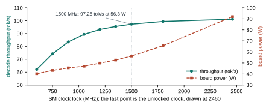
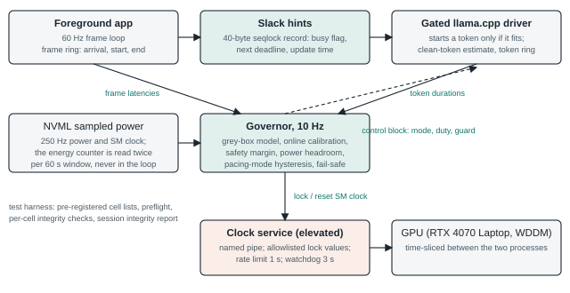
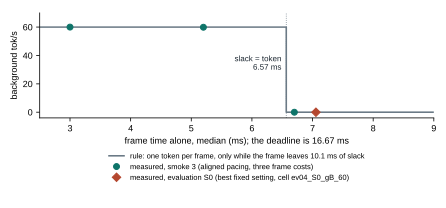

# A toolkit for sharing one laptop GPU between a 60 fps application and a local language model

Arjun Patil, 7 November 2026. Technical report on the repository `governor`.

This report describes an engineering toolkit that keeps a 60 fps frame loop on time while llama.cpp decodes on the same GPU, and the pre-registered evaluation that validated it on one laptop. The toolkit works where a token fits into the gap between frames. Where it does not fit, gap-filling gains nothing, and overlapping the token costs late frames. By the evaluation's registered reading the learned governor does not earn its place, and the report states that plainly. The hint protocol and the clock service are reusable, and the report records the measurement corrections found on the way.

## 1. Problem

The target is one consumer GPU, an RTX 4070 Laptop with 36 SMs and 8 GB, on Windows 11 with the WDDM driver model. nvidia-smi reports MIG mode as not available on this device, and no MPS is in use, so the two processes share the GPU by time-slicing alone. The foreground is a synthetic compute-bound frame loop at 60 Hz with a deadline of 16.67 ms and a nominal cost of 7 ms at an SM clock of 1800 MHz. The background is llama.cpp decoding a local model: Llama-3.2-3B in most runs, with a 1B model and Phi-3.5-mini in tuning and a held-out Llama-3.1-8B in the unseen scene. A mean board power budget applies, 60 W as the primary case and 35 W as an exploratory one. The requirement is at most 1% late frames and as many background tokens per second as the budget allows.

Without management the frame loop pays for the sharing. In the two scenes where the frame cost changes during the run, 34.1% and 34.65% of frames were late at median board powers of 89.9 W and 90.5 W (medians over the 10 uncontrolled cells of each scene). In the steady scene and the scene with idle phases no frames were late, but the board drew 90.5 W and 91.6 W, well above the budget.

## 2. What was measured first

Four measurements from the first two phases of the project shaped the design. The first is the clock law of a compute-bound frame. With the SM clock locked, frame service time relative to 1800 MHz was 1.999, 1.500 and 1.203 at 900, 1200 and 1500 MHz, against predictions of 2.000, 1.500 and 1.202. A compute-bound frame therefore slows one for one with the clock, and the clock of a task with a deadline can be lowered only as far as its slack allows.

Decode behaves differently, because llama.cpp token generation is limited by memory traffic (Figure 1). At 1500 MHz the 3B model produced 97.25 tok/s at 56.3 W, against 101.1 tok/s at 92.0 W with the clock unlocked: 96% of the throughput for 39% less board power. Energy per token was lowest at 1050 MHz, 0.526 J against 0.915 J unlocked. A half-precision stand-in for decode had put the knee at 1050 MHz while the real engine needed 1500 MHz, so the clock has to be measured on the engine that will run.

<figure><figcaption>Figure 1. Decode throughput flattens above 1500 MHz while board power keeps rising, which is the room the clock lock exploits.</figcaption></figure>

The third measurement concerns two processes on one GPU. A timeline measurement of the WDDM scheduler gave a fitted slice of 0.374 ms and a switch gap of 0.148 ms. In a later smoke test a token overlapped by a frame took 2.05 times as long, and the frame 1.95 times as long. Overlap is expensive for both sides.

The fourth is a failed hypothesis. The standard queueing picture says that a foreground request waits for the remainder of the background slice, so that the wait grows with slice length. The pre-registered test did not support it. In a secondary fit the wait levelled off near 0.26 ms and did not depend on the arrival phase. I dropped queueing as the model for frame latency. The governor uses a measured table of interference and corrects it online, and the first-order protection for frames is to avoid overlap, which requires the foreground to say when it is busy.

## 3. Design

Figure 2 shows the parts and the direction of the data. The foreground app publishes slack hints through a 40-byte shared-memory record that holds a seqlock counter, a busy flag, the time of the next deadline and the time of the update. The app sets the busy flag about 1 ms before each frame and clears it, together with the next deadline, when the frame completes. A consumer starts a unit of work only if the app is not busy and the current time plus its duration estimate plus a guard time is no later than the next deadline. A record older than 100 ms means the app is idle and the consumer runs freely. Reads go through the seqlock, and a read that fails because the writer is mid-update keeps the last good value. docs/SPEC_FRAME_SLACK_HINTS.md specifies the layout and the rules and lists the failure modes, and include/slackhint.h with a Python binding implements them, with 22 tests.

<figure><figcaption>Figure 2. The foreground publishes slack hints, the governor reads frame and token timing and writes the control block, and only the clock service touches the SM clock.</figcaption></figure>

The gated driver is a modified llama.cpp decode program built on a pinned llama.cpp commit. It reads the hint record and a control block of three values written by the governor: pacing mode, duty and guard time. In aligned mode it applies the start rule above. In unaligned mode it ignores the deadline and throttles by duty alone, which permits overlap. The driver aborts if any layer is not on the GPU. Its duration estimate is the median of the last eight tokens that did not overlap a frame, because an average over all tokens is inflated by the roughly doubled duration of the overlapped ones.

The governor runs ten times a second and chooses clock, pacing mode, duty and guard. Its model is grey-box. Frame time is an estimated cost at 1800 MHz multiplied by the clock law from section 2, token time and power come from the clock sweep, and the slowdown under overlap comes from the measured interference table. Three estimates are corrected online: the frame cost from recent latencies, a multiplier on the interference prediction from the ratio of observed to predicted 95th-percentile latency, and a power bias from measured minus predicted power. Among the candidates the governor keeps those whose predicted 95th-percentile frame time is below 0.7 of the deadline, which is 11.7 ms, and whose predicted power plus bias fits the steering budget, then takes the one with the most tokens per second. The steering budget is the 60 W limit minus a measured headroom of 2.692 W, divided by 0.97, which is 59.08 W. A late frame adds 1 ms of extra margin, up to 6 ms, and the margin decays by 0.1 ms per tick. If no candidate is safe, the governor selects the fastest clock and pauses the background. Both pacing modes are planned at every tick, and the executed mode changes only when the other predicts 1.2 times the tokens plus 2 tok/s on two consecutive one-second checks. After five ticks without frames the governor drops to 1500 MHz and lets the background run freely.

The clock service exists because locking the SM clock needs administrator rights, and the governor should not have them. It is a small elevated process that talks to the governor over a named pipe that only the same user can open. It accepts four commands, and lock values only from an allowlist in an administrator-owned file. Lock changes are rate limited to one per second. A watchdog releases the lock after 3 s without a message, and the lock is also released on start-up and on every exit path, including a client disconnect. A security review found one high-severity failure-handling defect, a failed reset that was forgotten, which was fixed with tests. The review was done by a model-based agent and is not a human audit.

The test harness is part of the design. The suite has 713 passing tests and one skip; the executable build test is excluded so that the registered binary stays unchanged. Hardware runs go through one executor with a preflight (AC power, a stated Armoury Crate mode, no browser running, a clean committed tree, uptime under two hours), a per-cell check that every layer is offloaded, two independent power measurements and an integrity report written after each session without reading any outcome.

## 4. Validation

The evaluation was pre-registered in experiments/w5_governor.yaml, committed on 2026-10-23, with dated addenda, and its constants were frozen in a hashed file before the first evaluation block. It has ten blocks. Within a block the cells run in a seeded random order. A block holds five managers in five scenes at 60 W plus the uncontrolled arm in each scene, which is 30 cells, and in five of the blocks 25 further cells at 35 W, so the total is 425 cells. A cell is a 5 s warm-up and a 60 s measured window, about 100 s of wall time with set-up and cool-down.

The scenes are S0, a constant frame cost; S1, a cost that steps between 0.7 and 1.3 times nominal every 10 s; S1d, a linear drift from 0.7 to 1.3 times nominal; S2, a steady cost with the app idle from 20 s to 30 s and after 50 s; and S5, the S1 frame loop with the held-out 8B model, which was never used for tuning. The managers are the uncontrolled arm, the best fixed setting (1800 MHz, aligned, found on tuning cells), the fixed setting with the idle rule, a reactive controller (a PI controller with both pacing modes, constants chosen on a tuning grid, with a second variant as a secondary comparator), and the governor.

A cell scores its background tok/s if it is feasible, meaning at most 1% late frames and mean board power within budget on the energy counter, and zero otherwise. Infeasible cells are kept in the analysis. Cells are paired by block. The registered tests are superiority of the governor in S5 against three comparators (exact one-sided Wilcoxon tests, Holm correction), non-inferiority in S0 and S2 (a score ratio whose 90% bootstrap lower bound is at least 0.95), and feasibility in every scene (at least 90% of cells feasible and a mean late share of at most 1%). The governor earns its place only if all of them pass.

Every power figure in the registered analysis and in this report is a difference of two energy-counter reads, one at the start and one at the end of the 60 s window, divided by 60 s, so each cell used two reads. The sampled power stream (NVML instantaneous power, about 250 Hz) is not a registered figure. It steers the governed controllers, it fills the 0.5 s traces stored with each cell, and its window mean is kept in a results column that no registered test reads. The source of each figure in the results file and in the descriptive table is listed in docs/AUDIT_590W.md, including its addendum.

A session of two blocks takes an estimated 2.4 hours, with a restart beforehand. A block that is interrupted is discarded whole and rerun under a new number with the same seed list. Twelve blocks were started and two were discarded: block 6 never measured a cell after three failed starts, and block 7 held 31 of 55 cells when I stopped the session. They ran again as blocks 14 and 15. The integrity report over the ten complete blocks covers 425 cells and lists no problem.

## 5. Results

Table 1 gives the medians at 60 W. The uncontrolled arm is never within the power budget. The best fixed setting and the fixed setting with the idle rule have a median of zero late frames, apart from 0.04% in S2, but they deliver background tokens only where a token fits between frames.

| Scene | Uncontrolled | Best fixed setting | Fixed setting with idle rule | Reactive controller | Governor |
|---|---|---|---|---|---|
| S0 | 48.1 / 0.00 / 90.5 | 0.0 / 0.00 / 30.2 | 0.0 / 0.00 / 30.5 | 18.1 / 0.00 / 58.4 | 17.5 / 0.00 / 58.8 |
| S1 | 47.7 / 34.10 / 89.9 | 20.0 / 0.00 / 40.9 | 20.0 / 0.00 / 40.8 | 13.8 / 6.28 / 38.9 | 19.4 / 1.72 / 55.8 |
| S1d | 48.3 / 5.42 / 90.1 | 16.6 / 0.00 / 38.9 | 16.7 / 0.00 / 39.9 | 12.8 / 2.54 / 33.8 | 17.9 / 0.25 / 59.0 |
| S2 | 64.2 / 0.00 / 91.6 | 32.0 / 0.04 / 42.7 | 31.4 / 0.04 / 39.5 | 31.5 / 1.88 / 45.3 | 41.3 / 0.04 / 58.2 |
| S5 | 23.0 / 34.65 / 90.5 | 0.0 / 0.00 / 30.3 | 0.0 / 0.00 / 30.5 | 0.8 / 11.07 / 25.6 | 7.8 / 4.72 / 58.1 |

Table 1. Medians over the 10 cells of each entry at 60 W, as background tok/s / late frames in percent / board power in watts. An entry meets the limits when the second number is at most 1 and the third at most 60.

The clearest effect of adaptation is in S2. When the app goes idle the governor gives the whole GPU to the background, and it reaches 41.3 tok/s at 0.04% late frames, against 32.0 for the best fixed setting and 31.4 for the fixed setting with the idle rule. The registered non-inferiority test in S2 against these two comparators passed on real ratios, 1.289 with a 90% interval of 1.282 to 1.310 and 1.310 with an interval of 1.304 to 1.336. In the drifting scene S1d the governor also leads, 17.9 against 16.6 and 16.7 tok/s, at 0.25% late frames.

The limit that dominates the other scenes is the size of a token against the gap between frames (Figure 3). A clean 3B token takes 10.1 ms, and a frame of 7 ms nominal cost leaves 9.67 ms, so no token fits: with aligned pacing the best fixed setting and the idle-rule setting produced no token in the measured window in any of the 40 cells of S0 and S5. They count as feasible and score zero. In S1 the frame cost is 0.7 times nominal for two of the six 10 s segments, where a token fits, and 60 tok/s for a third of the time is 20 tok/s, close to the 19.97 tok/s the same setting delivered. At a frame cost below about 6.6 ms the rule yields one token per frame, 60 tok/s at 60 Hz, which the smoke test confirmed at two frame costs.

<figure><figcaption>Figure 3. Aligned pacing delivers about 60 tok/s while the frame leaves room for a token and nothing once it does not, and the measured points follow that step.</figcaption></figure>

When nothing fits, the governor switches to unaligned pacing, which allows a token to overlap a frame. It ended in unaligned pacing in all 75 of its cells. That recovers tokens (17.5 tok/s in S0, 7.8 in S5) and costs late frames: 1.72% in S1 and 4.72% in S5 (Figure 4), both above the 1% limit in every block. The mechanism is probably the cost of interleaving under WDDM time-slicing, but the data do not isolate it and I treat it as a hypothesis. A second contributor was the tuning rule for the safety margin, which took the mean late share over six cells. The six-cell mean was 0.875%, hiding 2.0% for the 3B model in S1 and 3.25% for Phi in S1 (the S0 cells had none), so the per-scene misses were visible in the tuning data and the averaged rule did not use them.

<figure><figcaption>Figure 4. Each point is one cell, filled for 60 W and open for 35 W, and the dashed line is the 1% late-frame limit; only points near the bottom of a panel meet it.</figcaption></figure>

The registered verdict is that the governor does not earn its place. Its feasibility fails in S1 and S5 with zero feasible cells of ten in each. The superiority test in S5 is inconclusive because every arm scored zero in every block, so the exact test had nothing to rank. Non-inferiority in S0 against the primary reactive controller failed, with a median ratio of 0.973 and a 90% interval of 0.943 to 0.980, short of the 0.95 lower bound. The other five non-inferiority tests passed, two on real ratios (S2 against the two fixed settings) and three vacuously because the comparator scored zero or was never feasible. At 35 W the governor did not hold the budget: it was feasible in none of 25 cells, and its median power in S1 was 37.7 W. Only the two fixed settings held feasibility at 35 W, and not in every scene.

### Sensitivity to the energy-counter read overhead

The registered results are close to the power budget in two cells. I tested how sensitive they are by removing a worst-case energy-counter read overhead from every cell: 0.25 W, extrapolated from O-5 measurements at a higher read rate and not measured at the two reads each cell used. Two cells become feasible (ev09_S0_cBb_60 at 60.237 W against 60 W, ev14_S1_eB_35 at 35.178 W against 35 W), and three of 383 registered outputs move:

- S0 non-inferiority vs c'B-T3b (60 W, primary): 0.973, [0.943, 0.980], 8 blocks, FAIL becomes 0.979, [0.954, 0.980], 9 blocks, pass.
- HW1 for c'B-T3b in S0 (60 W): feasibility 0.8 to 0.9, not holding to holding.
- HW1 for eB in S1 (35 W, exploratory): feasibility 0.8 to 1.0, not holding to holding.

No other output changes, including HW1 for the governor (d'B) in every scene, so its overall verdict stands. At the single-read bound (0.125 W) nothing changes. I report the registered results; the energy-read sweep in Future Work would settle which reading is correct.

A learned predictor was tried before the evaluation and did not change the design. On 271 held-out cells, a gradient-boosted model of feasibility made 1 false-feasible call (0.8%), against 39 (22.5%) for the analytic grey-box model, but it failed the registered coverage gate with 88.2% against 90%, and no candidate passed all gates. The registered fallback kept the grey-box model.

## 6. Engineering lessons

The most costly defect was in the measurement. The NVML energy counter, read once per governor tick, added phantom energy. In a diagnostic with the best fixed setting run through the governor loop, the counter read 114.3 W while the sampled power read 39.6 W, and the same setting on the static path read 41.1 W on the counter and 39.7 W sampled. The loop read the counter 10.02 times per second. Without those reads the loop matched the static path at 40.6 W. Because the governor used the counter as its power signal, it throttled the background against power it was not drawing: the reactive controller rose from 5.7 to 12.7 tok/s when its loop switched to the sampled source. Comparing two independent power readings caught this. The per-read size was not constant, 7.5 J in one state and 2.7 J in another, so an earlier figure of 4.2 J failed as a prediction. Governed cells now read the energy counter only twice, at the window edges, and steer on the sampled source. Both sources are NVML readings and no external wall meter was used, so an error common to both would not be visible. A power sample of 590 W appeared in direct NVML reads on 6 November, a value the GPU cannot draw. The limits in section 7 describe it. Counter and sampled means agreed within 15% in all 425 cells.

The tuning rule that averaged six cells is the second lesson, described in section 5: targets belong to a condition, and an average over conditions hides the one that fails. The third is the torn-read bug. The first version of the driver treated a failed read of the hint record as an idle app, so it started tokens at every publish whatever the guard. In a reproduction without the GPU the old policy saw 25368 such polls in 5 s and the fixed policy none. The earlier smoke-test numbers from that driver were declared invalid. The same investigation produced the clean-token estimate. Two smaller problems also changed the work. A fallback in the reactive controller's constant selection picked a setting that delivered 0.6 tok/s, which led to a second comparator being added before any evaluation block, and a headroom computed from the wrong cells (2.84 W against the registered 2.692 W) was found after the governor's confirmation runs and disclosed instead of rerun.

## 7. Limits and next steps

Everything here is one laptop, one GPU, one driver and one synthetic foreground. The hint protocol was checked by its tests and a mechanism reproduction and used throughout the evaluation, but there is no controlled comparison against a run without hints, and the staleness of the token estimate after a clock change was logged and never analysed.

One limit concerns the sampled power. After the evaluation, first seen on 6 November, the NVML instantaneous-power reading on this driver (616.92) returned about 588 W while the GPU was idle, in runs of about half a second, and nvidia-smi printed the same value, so the fault is in the driver. The registered power figures are energy-counter differences and do not use that reading, and the audit found no sampled reading above 150 W in any stored record (docs/AUDIT_590W.md). The stored traces hold 0.5 s bin means and not raw samples, so a glitch shorter than one update cannot be excluded for the evaluation cells. The v2 samplers (branch v2-foreground, commit 8244b6e) now reject readings above 1.5 times the card's 140 W power limit at collection time and store the per-bin maximum.

The finding that limits the toolkit most is the size of the work unit against the frame slack. A token of 10.1 ms does not fit a gap of 9.67 ms, and the only option left is overlap, which costs late frames. The direct answer is a preemptible layer-group decode: a token runs as a few groups of layers, each short enough to fit the gap, so that the slack cliff disappears. An earlier project on chunked GPU launches measured what that costs: each chunk boundary is a global barrier, per-chunk time followed a barrier model with an R-squared of 0.97 to 0.98, and host overhead was only 2 to 34 ms per run. Chunking therefore has a price that is paid inside the kernels, and whether a llama.cpp decode token can be split at all is untested. That is the experiment I would run next, with the barrier cost measured on the decode graph itself. The energy-read sweep of docs/W5B_ENERGY_READ_SWEEP_PROTOCOL.md is the other open experiment: it would measure the phantom energy per counter read against GPU state, including at the two reads per cell used here, and so settle which reading of the sensitivity analysis is correct.

The second step is to replace the synthetic frame loop with frame-time capture from a real application, whose cost distribution is unlikely to match the step and drift patterns used here. The third concerns portability. The protocol code is Windows only, and on a Linux system with MPS or MIG hardware partitioning could change what a hint is worth, which I have not tested.

## 8. How it was built

The implementation was written with AI coding assistants (Claude Code sessions) under a protocol I designed. Hypotheses and thresholds were registered before the data they apply to, a second assistant session acted as reviewer through files in the reviews directory with me arbitrating, and every session ended with a journal entry and, for design choices, a decision record. The problem definition, the choice of Windows as the primary platform, the archiving of the earlier chunking project, the registered thresholds and the arbitration of reviewer findings, including the decision to evaluate two reactive comparators, were mine. The assistants wrote the code and tests and the first drafts of the documents, and the review agent's output is model output.
