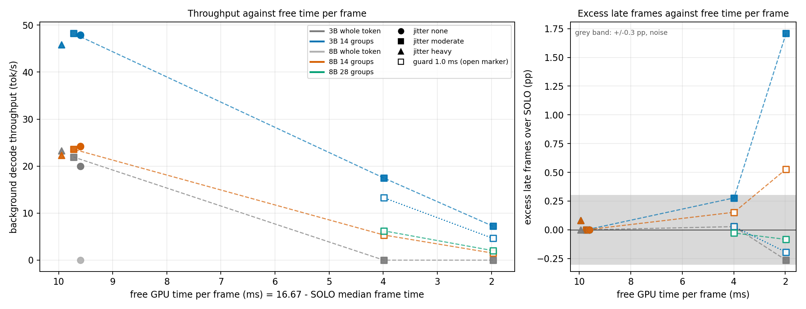

# Pausable LLM decode: sharing a laptop GPU with a 60 fps app

Arjun Patil, 8 November 2026. Technical report on the repository `governor`, release v2.0.0. It follows the v1 report (`docs/report/REPORT.pdf`).

llama.cpp decodes a token as one CUDA graph, so a language model sharing a GPU with a 60 fps app can start a token only if a whole token fits between frames. I split the token into layer groups with a pause point between them and gate each group on the app's frame hint. Pausing makes a token 1.4% to 2.2% slower. When the app leaves about 10 ms free per frame, the pausable gate more than doubles the 3B model's throughput and gives the 8B model a throughput where the whole-token gate gives none, with no late frames added. When it leaves about 4 ms, the whole-token gate stops and the pausable gate still decodes. The foreground in every measurement is a synthetic kernel loop, and the gates are static rules with a fixed margin. This is not a registered comparison with the v1 governor, and many of my forecasts were wrong; section 5 lists them.

## 1. Problem

The v1 evaluation found a slack cliff. A clean Llama-3.2-3B token takes 10.1 ms, and a synthetic frame of 7 ms nominal cost in a 16.67 ms period leaves 9.67 ms, so no token fits. With aligned pacing the best fixed setting produced no token in the measured window in any of the 40 cells of the scenes S0 and S5. Where tokens did fit, in S1, the same setting delivered 19.97 tok/s. When nothing fits the learned governor switched to unaligned pacing, which recovers tokens (17.5 tok/s in S0, 7.8 in S5) and costs late frames: 1.72% in S1 and 4.72% in S5, against a 1% limit.

The cliff follows from the token being indivisible. A gate that starts only units that fit gets throughput in proportion to how many whole tokens fit in the gaps, which is zero when the token is longer than the typical gap. If decode could stop at layer boundaries, a gap shorter than a token would still be usable, and the unit that has to fit would be a group of layers. The question of v2 is whether that holds on this hardware (an RTX 4070 Laptop on Windows 11 with WDDM) with a 60 Hz app and two models (a 3B and an 8B), and how far it goes as the gap shrinks.

## 2. Mechanism

I patched the pinned llama.cpp (commit 620d2225c, version 0.7.0) so that, with `GGML_CUDA_PAUSE_GROUPS=G`, one token's compute graph is cut after layer boundaries into G groups. Each group runs through the unchanged capture and launch path and so becomes its own CUDA graph. After each group the host synchronises the stream and calls a hook, which in my driver reads the frame hint and waits until the next group is predicted to finish before the next deadline: the app is not busy and now plus the group's predicted time plus a guard is at most the next deadline. Each group index has its own duration estimate, the median of its last 8 clean durations. The guard is the early-start margin. The patch, the `ggml_graph_view` workaround (that function is not exported from ggml-base.dll, so the patch copies the graph struct) and the build steps are in `docs/PAUSABLE_DECODE.md`.

Pausing is cheap. At 1500 MHz the 3B token takes 10.14 ms whole and 2.2% longer with 14 groups, with a longest uninterruptible piece of 1.95 ms; with 28 groups the cost is 4.3% and the piece 1.63 ms. The cost per boundary is 16 to 31 microseconds. The 8B costs 1.4% at 14 groups (longest piece 3.61 ms) and 2.9% at 28 (2.99 ms). The tokens are identical to the stock run in every configuration. Turning CUDA graphs off instead would cost 14.2%. A control that forced a 2 ms wait at every boundary lengthened the token by the expected amount (6.07 ms against 6.0 at G = 4), so each boundary is a real pause point. The output head is the floor under the longest piece: about 1.3 ms for the 3B and 2.4 ms for the 8B. Prefill is not split.

## 3. Method

Four sprints, each with a question and a decision rule, and a forecast with ranges. The forecast and rule were committed and pushed before any data of the sprint existed (commits 83db807, 09a0cd0, 447105e and b24edae), and each sprint document ends with a table of forecast against measured. The foreground is the v1 synthetic 60 fps loop of FMA kernels in one process, publishing the hint live; the decode is in a second process. Cells run at a locked SM clock (1500 MHz for the pause-cost profile, 1800 MHz for everything end to end), a 5 s warm-up and a 60 s measured window, with power from two reads of the NVML energy counter and a sampled-power stream guarded against the 588 W glitch of this driver (no sample was rejected in any end-to-end cell). The gate waits by spinning, with guard 0 unless stated.

Late frames are measured against the nominal schedule. From sprint 3 on, every level has a SOLO cell, the app alone with the same seed and the same frame sequence, and an arm's excess late is its late-frame percentage minus the SOLO percentage, so that decode is not blamed for lateness the app has on its own. Jitter is synthetic and seeded: lognormal frame cost (coefficient of variation 0.15 moderate, 0.30 heavy, plus 2x spikes in 2% of heavy frames), submit time within plus or minus 1 ms (moderate) or 2 ms (heavy) with the hint updated only at the real submit, and unannounced 0.5 to 1.5 ms bursts in 5% or 10% of frames. Excess-late differences within about 0.3 percentage points are noise at this design's size and I do not read them as effects.

| Sprint | Question | Arms | Cells |
|---|---|---|---|
| 1 | What does a pause cost? | G = 1, 2, 4, 7, 14, 28 (3B), graphs off, forced-wait control | 3 reps of 300 tokens each |
| 2 | Does the foreground get the GPU faster, and does throughput rise? | handover cells; S1 3B and S5 8B, whole-token gate against 14 groups | 12 end-to-end |
| 3 | Does jitter turn into late frames? | SOLO, 3B whole token, 3B 14 groups, 8B 14 groups at 3 jitter levels | 28 |
| 4 | What happens as free time per frame shrinks to 4 and 2 ms? | SOLO, 3B whole token, 3B 14 groups at guard 0 and 1.0, 8B 14 and 28 groups at guard 1.0 | 24 |

## 4. Results

Sprint 2 is where the idea was tested on hardware, and it overturned the premise of the forecast. I had expected a foreground frame submitted during a whole token to wait about one token (10 ms) and, with 14 groups, about one group (2 ms). The measured wait for the first foreground kernel was the same for both: a median of 0.477 ms, a p99 of 0.87 ms and a maximum of 1.69 ms over 6,172 frames submitted mid-token, against a median of 0.477 ms for frames submitted mid-group. WDDM time-slices between processes (a fitted slice of 0.374 ms and switch gap of 0.148 ms from the v1 work), so the foreground does not wait for the graph to finish. It shares the GPU and its frame runs slower. Pausing does not hand the GPU over faster. It reduces overlap and lets a gate use gaps shorter than a token, and the end-to-end cells measure that. With the gate on at 1800 MHz and guard 0, the whole-token gate gave 19.95 tok/s in S1 (3B), matching the registered v1 setting's 19.97, and 0.0 tok/s in S5 (8B). The 14-group gate gave 47.9 and 24.2 tok/s. Every one of the 12 cells had 0.00% late frames, so the gain is in throughput and not in lateness; the whole-token gate never had late frames to lose because it starts only tokens that fit.

Sprint 3 asked whether the gate keeps frames on time when the app is irregular. At the moderate and heavy levels the 14-group gate delivered 48.2 and 45.9 tok/s against 21.9 and 23.3 for the whole-token gate, and its excess late frames over SOLO were 0.00 and 0.08 percentage points, against limits of 1 and 2 (rule: PASS). Both numbers are inside the noise band. Jitter made the group gate touch 16% to 35% of frames (0.1% to 0.8% without jitter) with short touches, a slowdown of the touched frame of 1.2 to 1.7 at p99. About 97% of the late frames at heavy were the app's own. The frames had 8 to 11 ms of slack, which limits what the test can show.

Sprint 4 removed that slack. I calibrated the constant-cost foreground so that the SOLO median frame time was 12.68 ms (TIGHT, 3.99 ms free per frame) and 14.70 ms (VERY TIGHT, 1.97 ms free), against targets of 12.5 and 14.5 ms, and ran moderate jitter at both. VERY TIGHT is a stress test: the app alone misses 29.3% of its frames there, and 3.85% at TIGHT. Table 1 gives the result.

| Arm | TIGHT tok/s | TIGHT excess late (pp) | VERY TIGHT tok/s | VERY TIGHT excess late (pp) |
|---|---|---|---|---|
| 3B whole token | 0.0 | +0.03 | 0.0 | -0.26 |
| 3B 14 groups, guard 0 | 17.5 | +0.28 | 7.2 | +1.71 |
| 3B 14 groups, guard 1.0 | 13.3 | +0.03 | 4.6 | -0.19 |
| 8B 14 groups, guard 1.0 | 5.4 | +0.15 | 1.5 | +0.53 |
| 8B 28 groups, guard 1.0 | 6.2 | -0.03 | 2.0 | -0.08 |

Table 1. Sprint 4, two reps pooled (7,200 frames per arm and level). Excess late is relative to SOLO at the same seed.

By the decision rule fixed beforehand the best 3B group arm passes at both levels: the guard-0 arm at +0.28 pp (limit 1) at TIGHT and +1.71 pp (limit 2) at VERY TIGHT. The TIGHT figure is within the noise band, so the supported statement is that no lateness was detectably added. The VERY TIGHT pass is on the mean of two reps and rep 1 is over the limit: +2.28 pp in rep 1 and +1.14 pp in rep 2. The +1.71 pp and the 8B's +0.53 pp are the only excesses in the whole study above the noise band, and both are in a regime where the app alone misses 29% of its frames. The whole-token gate gets nothing at either level, since a 10 ms token cannot start in a 4 ms gap. The 8B still decodes at TIGHT (5 to 6 tok/s) and collapses at VERY TIGHT (1.5 and 2.0 tok/s), where its output head of about 2.4 ms is longer than the mean free time.

The margin test failed its rule. A guard of 1.0 ms removed nearly all the late frames attributed to decode (21 to 2 at TIGHT, 80 to 3 at VERY TIGHT, pooled over the reps) but kept only 76% and 64% of the throughput; the rule allowed a loss of 15%. At VERY TIGHT the guard-0 arm's 80 attributed late frames were 54 overlaps that I could not tie to an early submit; 17 were early submits and 9 followed a burst. I did not find the cause of the 54.

Figure 1 puts every end-to-end condition of sprints 2 to 4 on one axis, free GPU time per frame. The 3B whole-token gate falls from 20 to 22 tok/s at about 9.7 ms free to zero at 4.0 ms, and the pausable gate falls from 48 to 17.5 to 7.2 tok/s. No condition between 9.7 and 4.0 ms free was measured, so the figure shows that whole-token decode is gone by 4.0 ms and not where between those points it stops.

<figure><figcaption>Figure 1. Left: background tok/s against free GPU time per frame (16.67 ms minus the SOLO median frame time) for every end-to-end condition of sprints 2 to 4; marker shape is the jitter level, open markers are guard 1.0 ms, and dashed lines join the moderate-jitter points. Right: excess late frames over SOLO against the same axis, with the plus or minus 0.3 pp noise band shaded. The conditions differ across sprints: sprints 2 and 3 use the S1 scene with guard 0 and the 8B at 14 groups, sprint 4 uses a calibrated constant-cost scene with moderate jitter and, for the 8B, guard 1.0; sprint 2 had no SOLO cell, so it uses the sprint-3 level-none SOLO median; the whole-token 8B point is at zero.</figcaption></figure>

## 5. Forecast against measured

Every forecast committed before a sprint is in the sprint document with its range. The table lists the quantities I forecast and marks the ones that failed.

| Sprint | Quantity | Forecast | Measured | Result |
|---|---|---|---|---|
| 1 | cost per boundary | 100 us (50 to 200) | 16 to 31 us | failed, about 6 times too high |
| 1 | overhead at 14 groups, 3B | 12.6% | 2.2% | failed, 5.7 times too high |
| 1 | overhead at 28 groups, 3B | 26.3% | 4.3% | failed, 6.1 times too high |
| 1 | longest group at 14 groups, 3B | 1.5 ms | 1.95 ms | failed (the head is 1.3 ms, not 0.8) |
| 2 | foreground wait behind a whole token | about 10 ms | median 0.477 ms, max 1.69 ms | failed, about 20 times too high |
| 2 | foreground wait with 14 groups | about 2 ms plus the switch | median 0.477 ms, same as whole token | failed in kind: shorter pieces did not shorten the wait |
| 2 | 8B output head | 1.8 ms | about 2.4 ms | failed |
| 2 | 3B tok/s, 14 groups against whole token | little difference (a few percent) | 47.9 against 19.95 | failed |
| 2 | 8B tok/s, 14 groups | a few to ten | 24.2 | failed |
| 2 | 8B tok/s, whole token; late frames in S1 and S5 | about 0; near zero | 0.0; 0.00% | held |
| 3 | SOLO late frames at heavy | about 3% | 1.31% | failed, overestimated |
| 3 | 14-group excess late at heavy | about 0.8 pp (0.2 to 2) | 0.08 pp | failed, overestimated |
| 3 | whole-token tok/s at heavy | 10 to 15 | 23.3 | failed (it rose) |
| 3 | verdict | PASS, no FAIL | PASS, no FAIL | held |
| 4 | SOLO late frames at VERY TIGHT | about 17% | 29.3% | failed, underestimated |
| 4 | 3B guard-0 excess late, TIGHT and VERY TIGHT | about +2 and +6 pp | +0.28 and +1.71 pp | failed, overestimated |
| 4 | which arm passes | guard 1.0 at TIGHT, none at VERY TIGHT | guard 0 at both | failed |
| 4 | 3B guard-1.0 tok/s at VERY TIGHT | about 1 (0 to 3) | 4.6 | failed, outside the range |
| 4 | 3B guard-0 tok/s at TIGHT | about 20 (14 to 24) | 17.5 | held |
| 4 | margin works | no (loss of about 35% against 15% allowed) | no (loss of 24% and 36%) | held; the margin rule failed |
| 4 | 8B at VERY TIGHT | collapses | 1.5 and 2.0 tok/s | held |

Table 2. Forecast against measured, all sprints. The sprint documents give the full tables.

The failures mostly share a direction. I overestimated the costs I modelled (the pause cost, the handover wait, lateness) and underestimated what the gate could recover. The exception is SOLO lateness at VERY TIGHT, which came from a lognormal calculation that placed the frames further from the deadline than they were, together with a 0.2 ms difference between the calibration cells and the 60 s cells that matters when 2 ms are free.

## 6. Limitations

The foreground is a synthetic kernel loop of FMA work, not a renderer. A real app has correlated costs, submit times tied to a compositor, and work that overlaps frames; the jitter here is independent between frames and the model is mine. The gates are static rules with a fixed guard. The work is not a registered comparison with the v1 governor, and I make no claim that pausable decode beats it; the v1 governor was not run against the 14-group gate. There is no power control: the 3B 14-group arm draws about 58 W and the 8B arm 59 to 60 W (60.3 W once, at jitter level none, above the 60 W budget of the v1 evaluation).

The statistics are small. Sprint 4 has two reps per cell and sprints 2 and 3 have three, all on one laptop with one GPU and one driver version. Excess-late values within about 0.3 percentage points are noise, which covers every excess in sprints 2 and 3 and the TIGHT level of sprint 4. At VERY TIGHT, where the app alone misses 29% of its frames, the pass rests on the mean of two reps with rep 1 over the limit. I did not establish why most of the guard-0 arm's overlaps are not early submits, and the estimator, which drops groups that overran, may lag after a run of overruns.

Prefill is not split, so a long prompt remains an uninterruptible batch of GPU work. The longest piece is bounded below by the output head (1.3 ms for the 3B, 2.4 ms for the 8B), which is why the 8B collapses first. The conditions of the sprints differ (foreground scene, guard, calibration), so Figure 1 joins points that are not one measured curve. The sprint-4 SOLO medians are 0.2 ms above the calibration cells, and I report them as measured.

## 7. Future work

The guard of 1.0 ms removed the collisions and cost a quarter to a third of the throughput because it is flat: it charges every gap the same margin whether or not the group is likely to overrun. A p90 duration predictor per group in place of the median plus a flat margin would charge a margin only where a group's duration spread requires it; the per-group durations in the committed data (`decode_groups.csv` of each cell) allow it to be fitted offline before any hardware run. The synthetic foreground should be replaced by a real renderer, to test whether the hint protocol survives a compositor and how the app's own late frames change. The 14-group gate draws 58 to 60 W with no control, so the v1 governor's clock and power control should be put on top of the gate and compared with it under the registered protocol, which this report does not do. Correlated jitter, a heavy scene that lasts many frames, would test the gate where its estimate lags most.

## Sources

The claim-to-source table is `docs/report/SOURCES_V2.md` and the style check against `docs/WRITING_STYLE_GUIDE.md` is `docs/report/STYLE_CHECK_V2.md`. The mechanism is described in `docs/PAUSABLE_DECODE.md`, the measurements in `docs/V2_SPRINT1_PAUSE_COST.md` to `docs/V2_SPRINT4_LOW_SLACK.md`, and the figure is made by `tools/v2_figure.py` from the committed data in `data/v2`.
